# Use-case flows — `mobile-dev-skills`

The maintainer's use-case reference: a map, drawn on 2026-11-18 for plugin version `0.1.0-alpha.1`, of every way into the `mobile-dev-skills` plugin (`plugins/mobile-dev-skills/`) and the path each one takes, as one Mermaid flowchart per use case. Sources: every `skills/*/SKILL.md` and `skills/feature-workflow/*.md`, the headers of `feature-spec/scripts/check_spec.sh` and `mobile-store-deploy/scripts/*.sh`, `agents/*.md` (frontmatter and "Inputs from feature-workflow"), the three adapters' `PLATFORM.md` (Flutter, SwiftUI and Jetpack Compose), the plugin README, `MIGRATION.md` and the repo's `CLAUDE.md`. The charts simplify; where one disagrees with a skill, the skill wins. Three shared sub-flows (SF-1 to SF-3) are drawn once and named where a use case reaches them. The sibling plugins' skills (`crash-issue-fixer`, `store-submission-prep`, `figma-design-to-artifact`) appear only where a skill here offers them or they hand work back; this plugin never bundles or installs them.

**Legend.** Every chart uses the same node classes (its `classDef` lines are repeated in each block). Solid edges are the path, dotted edges an optional delegation, and edge labels name the branch.

| Class | Shape | Meaning |
|---|---|---|
| `skill` | `[["…"]]` subroutine, blue | a plugin skill, or a sibling plugin's skill, labelled "sibling plugin" |
| `agent` | `{{"…"}}` hexagon, purple | a plugin agent, or a built-in `general-purpose`, `Explore` or `Plan` subagent |
| `step` | `["…"]` rectangle, grey | a step inside a skill |
| `decision` | `{"…"}` diamond, orange | a branch |
| `user` | `(["…"])` stadium, yellow | input from the user |
| `gate` | `(["…"])` stadium, red border | an approval the run must wait for: the hard gate, compaction's Step 2 question, Play's rollout pause |
| `state` | `[("…")]` cylinder, green | a state-file write that changes a later path (resume point, index status) |
| `done` | `("…")` rounded, green | the path ends normally, a hand-back included |
| `stop` | `("…")` rounded, red | the path stops or is blocked |

## Index

| ID | Use case | Entry | Skills and agents |
|---|---|---|---|
| SF-1 | Platform adapter lookup | first step of `feature-workflow`, `feature-spec`, `feature-scaffold`, `feature-verify`, `mobile-build-deploy` | those skills; the Flutter, SwiftUI and Compose adapters |
| SF-2 | Saved stack and command decision | `feature-workflow` Step 1.2, `feature-scaffold` Step 1 | `feature-workflow`, `feature-scaffold`, `Explore`; the adapter's command rule (fvm, `xcodebuild` or Gradle) |
| SF-3 | Quality check, TBD loop, approval gate | `feature-workflow` Step 1.6 | `feature-workflow`, `feature-spec` (`check_spec.sh`) |
| UC-1 | New feature, Standard size | `/mobile-dev-skills:feature-workflow <feature>`, or a request that names the workflow | `feature-workflow`, `feature-intake`, `feature-spec`, `feature-scaffold`, `feature-verify`; `Explore`, `Plan`, `general-purpose`; reviewers and build fixers via UC-16/17 |
| UC-2 | Trivial change plan | same command; copy, a token or one element's look | `feature-workflow`, `Explore` |
| UC-3 | Small change | same command; one behavior on one screen | `feature-workflow`, `feature-intake`, `feature-spec`, `feature-scaffold`, `feature-verify` |
| UC-4 | Large feature split into sub-features | same command; several flows or a new module | as UC-1, plus `Plan` |
| UC-5 | Edit to a specced feature | same command; a change to a feature with a spec | as UC-1, plus `general-purpose` (`baseline.md` extension) |
| UC-6 | Edit to a never-specced feature: baseline spec | any non-trivial change, bug fix, refactor or missing-tests request on a feature without a spec | `feature-workflow`, `general-purpose` (`baseline.md`, `reading.md`) |
| UC-7 | Bug fix | same command with a bug report; `crash-issue-fixer` handing over a crash fix the user sends through the workflow | `feature-workflow`, `general-purpose` (`diagnose.md`), `feature-spec`, `feature-scaffold`, `feature-verify`; offers the sibling `crash-issue-fixer` |
| UC-8 | Refactor, incl. tests-only coverage | same command; "refactor …" | `feature-workflow`, `feature-verify`, `feature-spec`, `feature-scaffold` |
| UC-9 | Missing tests | `/mobile-dev-skills:feature-workflow add the missing tests for <feature>`; `feature-verify`'s offer | `feature-workflow` (`missing-tests.md`), `feature-verify`, `feature-scaffold` |
| UC-10 | Skipped tests | "skip the tests for …" before approval or in Phase 2 | `feature-workflow`, `feature-spec`, `feature-scaffold`, `feature-verify` |
| UC-11 | Resuming an unfinished run | the command on a feature with state, or `… continue [<slug>]` | `feature-workflow` |
| UC-12 | Delegated run from a monorepo parent | a project skill invokes `feature-workflow` with a `# Delegation brief` | `feature-workflow` (`delegated.md`) and the whole chain |
| UC-13 | Cross-part request without a brief | a direct request in a monorepo app that needs another part's work | `feature-workflow`, `feature-intake` |
| UC-14 | Hybrid native code | a Flutter spec whose section 4 lists native interfaces, permissions or capabilities | `feature-workflow`, `feature-scaffold`, `swift-build-resolver`, `swift-reviewer`, `kotlin-build-resolver`, `kotlin-reviewer`, `security-reviewer` |
| UC-15 | Provisional API shapes | "the backend isn't built yet", or a brief whose API contract is `draft` | `feature-intake`, `feature-spec`, `feature-scaffold` |
| UC-16 | Verification run, FAIL and build fixer | `feature-workflow` Step 2.3 (internal) | `feature-workflow`, `feature-verify`, `dart-build-resolver`, `swift-build-resolver`, `kotlin-build-resolver` |
| UC-17 | Review and its fix loop | `feature-workflow` Step 2.4 (internal) | `general-purpose` (`review.md`), `flutter-reviewer`, `swift-reviewer`, `kotlin-reviewer`, `security-reviewer` |
| UC-18 | `feature-intake` on its own | a feature description or requirements dump that doesn't name the workflow | `feature-intake` → `feature-spec`; offers the sibling `figma-design-to-artifact` |
| UC-19 | `feature-spec` on its own | "write the spec" with a populated Intake Sheet | `feature-spec` → `feature-scaffold` |
| UC-20 | `feature-scaffold` on its own | "build it", "scaffold the code" after approval | `feature-scaffold`, `feature-verify` |
| UC-21 | `feature-verify` on its own | "does the code match the spec", "verify the saved-articles spec" | `feature-verify` (the adapter's Test-name search and anchored-test command) |
| UC-22 | Spec compaction | "compact the spec" | `feature-spec-compact` (`check_spec.sh`) |
| UC-23 | Build and deploy | "bump to 2.4.0 and ship it to TestFlight/Play"; `store-submission-prep`'s offer for a build not uploaded yet | `mobile-build-deploy` → `mobile-store-deploy` |
| UC-24 | Deploy only: entry and iOS | "upload the archive to TestFlight"; `mobile-build-deploy`'s hand-off; `store-submission-prep`'s offer; a request for the store submission itself | `mobile-store-deploy` (`ios_find_archive.sh`, `ios_upload.sh`); offers the sibling `store-submission-prep` |
| UC-25 | Deploy only: Android, Phase 1 and Phase 2 | "upload the AAB to Play internal testing" | `mobile-store-deploy` (`android_phase_select.sh`, `android_phase1_upload.sh`, Claude in Chrome); the `store-submission-prep` offer as in UC-24 |
| UC-26 | Store deploy setup | "set up store deployment", or a deploy without `ios.json`/`android.json` | `mobile-store-deploy` |
| UC-27 | Upgrade from `flutter-skills` v0.2.0 | a project set up with v0.2.0 (`MIGRATION.md`) | all |

---

## Shared sub-flows

### SF-1 — Platform adapter lookup

Runs first in every skill that needs platform knowledge; a sub-skill invoked by `feature-workflow` takes its adapter.

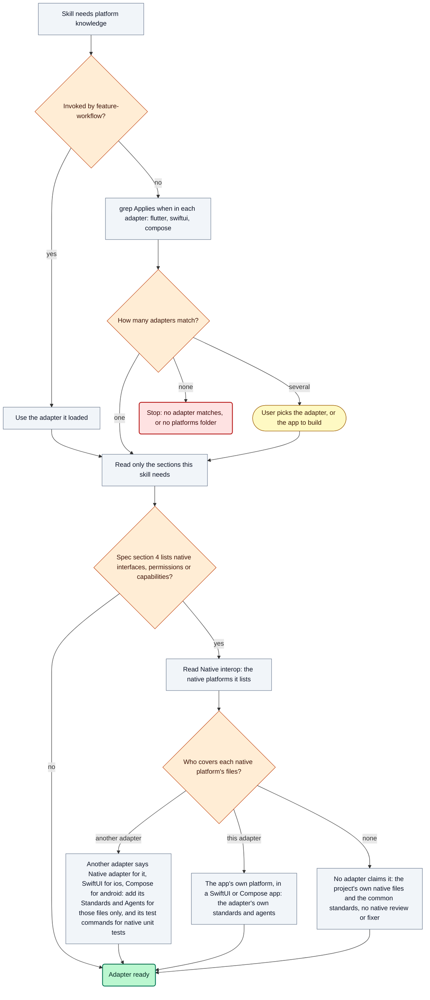

- Sections read: `feature-workflow` and `feature-scaffold` in full except "Native interop", and a scaffold chunk only "Project layout", "Commands", "Generation order" and "Templates"; `feature-spec` "Stack layer" and "Spec notation", plus the **Test-name search** line of "Commands" for anchors to existing tests; `feature-verify` and a trivial request "Project layout" and "Commands"; `mobile-build-deploy` "Project layout" and "Build adapter", plus "Commands" when "Build adapter" sends it there; the baseline subagent "Project layout", "Code entry points", "Spec notation" and the Test-name search, the diagnosis "Project layout", "Code entry points" and "Commands" (each skill's own "Platform adapter" paragraph; `baseline.md` and `diagnose.md` "Read first").
- The SwiftUI and Compose adapters' "Applies when" exclude a Flutter or React Native project's `ios/` and `android/` folders (Compose also a Kotlin Multiplatform project), so in a Flutter project each is reached only through `Native adapter for:`, as the native adapter of `ios` or `android` (swiftui and compose `PLATFORM.md` "Applies when", "Native interop").
- In a Flutter project's native folders only a native adapter's rules for every Swift file or every Kotlin file apply, its test rules to native unit tests, and its "Commands" run those tests; nothing else of that adapter is read (`feature-workflow` and `feature-scaffold` "Native adapters"; swiftui and compose `standards.md`).

### SF-2 — Saved stack and command decision

`feature-workflow` Step 1.2 and `feature-scaffold` Step 1; the scaffold adds the conventions layer.

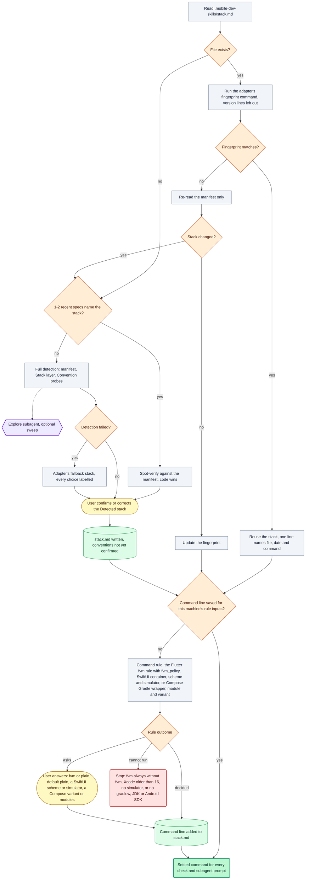

- A file without a `Test packages` line gets only that part detected; a changed stack resets the conventions to `not yet confirmed` (`feature-workflow` "Step 1.2", `feature-scaffold` "Saved stack").
- A trivial request reuses or adds a `## Command` line in an existing `stack.md` but never creates one (`feature-workflow` "Trivial: the change plan" step 2).
- Only the fvm rule reads a plugin option. A saved SwiftUI line matches while its container, scheme and simulator still exist, a Compose line while its module and variant do; otherwise the rule decides again (each adapter's "Commands").

### SF-3 — Quality check, TBD loop and approval gate

`feature-workflow` Step 1.6, after every spec save (new spec, update, bug fix, refactor).

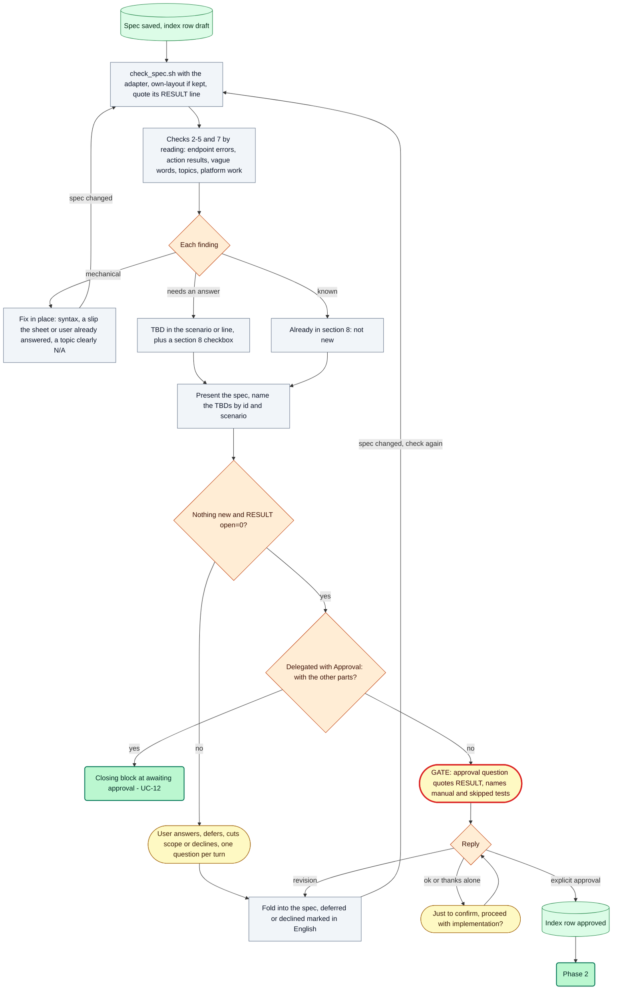

- The script decides checks 1 (states) and 6 (syntax, items, layout); exit 4 is a usage error, never a result (`feature-spec` "Quality check").
- In an update, a `states` finding on a screen the change doesn't touch is older: named, not fixed (`feature-spec` "Quality check").
- `deliberately deferred` and `declined` items don't count in `open`, nor does a `### Provisional shapes` list (`check_spec.sh` header; `feature-spec` "When the API is explicitly not ready yet").

---

## Feature workflow — request sizes

### UC-1 — New feature, Standard size

A new screen or flow, started with the command or by naming the workflow; the full two-phase path.

```mermaid
flowchart TD
  classDef skill fill:#dbeafe,stroke:#1d4ed8,stroke-width:2px,color:#0b1b3f
  classDef agent fill:#ede9fe,stroke:#6d28d9,stroke-width:2px,color:#1e1033
  classDef step fill:#f1f5f9,stroke:#64748b,color:#0f172a
  classDef decision fill:#ffedd5,stroke:#c2410c,color:#431407
  classDef user fill:#fef9c3,stroke:#a16207,color:#422006
  classDef gate fill:#fef9c3,stroke:#dc2626,stroke-width:3px,color:#450a0a
  classDef state fill:#dcfce7,stroke:#15803d,color:#052e16
  classDef done fill:#bbf7d0,stroke:#047857,stroke-width:2px,color:#022c22
  classDef stop fill:#fee2e2,stroke:#b91c1c,stroke-width:2px,color:#450a0a
  A0(["Command mobile-dev-skills:feature-workflow plus a new feature"]):::user
  A1{"Unfinished state for this feature?"}:::decision
  A2["Resume - UC-11"]:::step
  A3["Step 0: size Standard, size line opens the reply"]:::step
  A4["Step 1.1: mode new feature"]:::step
  A5["Step 1.2: detect stack - SF-2"]:::step
  A6[["feature-intake: six-section Intake Sheet"]]:::skill
  A7{{"Synchronous Q and A subagent, optional"}}:::agent
  A8[("intake.md, written as answers arrive")]:::state
  A9["Step 1.4: spec folder, naming, style, API reference"]:::step
  A10{{"Explore subagent, for what the index doesn't answer"}}:::agent
  A11[["feature-spec: ten sections, Handoff stopped after the save"]]:::skill
  A12[("intake.md Spec line, index row draft")]:::state
  A13["Step 1.6 - SF-3"]:::step
  A14(["GATE: explicit approval of the spec"]):::gate
  A15[["feature-scaffold Step 1"]]:::skill
  A16{"Conventions saved under a matching fingerprint?"}:::decision
  A17(["User confirms the Detected Stack and Conventions Report"]):::user
  A18["feature-scaffold Step 2: load the standards files, then the project's Skills line"]:::step
  A19[("tasks.md, then its Baseline and Standards lines")]:::state
  A20["Step 2.2 baseline on untouched code: Analyze, Tests, Format, Native build"]:::step
  A21["Generate in the adapter's Generation order, each layer's tests after it"]:::step
  A22{{"Implementation subagents per chunk, optional"}}:::agent
  A23{"A screen lacks its Loading, Error, Empty or Success answer?"}:::decision
  A24(["User answers before that screen is generated"]):::user
  A25["Fill spec anchors: enforced, test, Last verified line"]:::step
  A26["Step 2.3: verification run - UC-16"]:::step
  A27["Step 2.4: review - UC-17"]:::step
  A28[("report.md, index row implemented")]:::state
  A29("Done: scaffold's closing notes"):::done
  A30[["figma-design-to-artifact, sibling plugin, offered as in UC-18"]]:::skill
  A31["Native code, permissions, capabilities - UC-14"]:::step
  A32(["User's go-ahead after each ticked task: its files and test results shown"]):::user
  A0 --> A1
  A1 -->|yes| A2
  A1 -->|no| A3
  A3 --> A4
  A4 --> A5
  A5 --> A6
  A6 -.->|large gap-hunt| A7
  A6 -.->|Figma links, user agrees| A30
  A6 --> A8
  A8 -->|sheet done, intake returns here| A9
  A9 -.-> A10
  A9 --> A11
  A11 --> A12
  A12 --> A13
  A13 --> A14
  A14 -->|approved| A15
  A15 --> A16
  A16 -->|yes| A18
  A16 -->|no| A17
  A17 --> A18
  A18 --> A19
  A19 --> A20
  A20 --> A21
  A21 -.->|chunks| A22
  A21 -.->|section 4 native work| A31
  A21 -.->|project file says Pause after each task, or asked this run| A32
  A32 --> A21
  A21 --> A23
  A23 -->|yes| A24
  A24 --> A21
  A23 -->|no| A25
  A25 --> A26
  A26 -->|all PASS or SKIPPED| A27
  A27 -->|no open finding| A28
  A28 --> A29
```

- Invoked as Step 1.3, `feature-intake` returns the finished sheet to the orchestrator instead of handing it to `feature-spec`, since Step 1.4 comes before the spec (`feature-intake` "When intake is done"; `feature-workflow` "Step 1.3").
- Without a project docs convention the spec takes `feature-spec`'s default name, `<feature-slug>-feature-spec.md`, so features don't share a file (`feature-workflow` "Step 1.4"; `feature-spec` "The output template").
- Implementation subagents report files and anchors; only the orchestrator writes the spec and ticks `tasks.md` (`feature-workflow` "Step 2.2", Delegation bullet).
- The project's `.mobile-dev-skills/standards.md` may have a `## Workflow` part: its `Skills:` line is loaded by the scaffold's Step 2, the implementation subagents and the trivial path, and named on the `Standards:` line; `Pause after each task: yes` stops Step 2.2 after each ticked task, never the Spec anchors task or Steps 2.3 and 2.4 (`feature-scaffold` "Step 2"; `feature-workflow` "Step 2.2").
- The index row goes `draft` → `approved` → `implemented`, and `implemented` waits for both the verification run and the review (`feature-workflow` "Spec index").
- Some adapters need a test setup before Phase 2's first test: a SwiftUI app without a unit-test target gets one that the user adds in Xcode, and a Compose module without Robolectric and the Compose test libraries gets them as a new dependency the user approves, or, declined, its screen scenarios are tested on the ViewModel (swiftui and compose `PLATFORM.md` "Project layout").
- A new file joins its target with no project edit, except in a group-based Xcode project, where the user first chooses between adding it in Xcode and a project-file edit (swiftui `PLATFORM.md` "Project layout", File registration).

### UC-2 — Trivial change plan

The request changes only copy, a color or spacing token, or one UI element's look: no state, data, request, route or action.

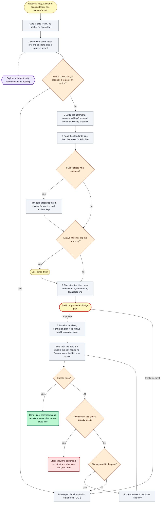

- Nothing is written but the edit: no intake, tasks or report, and the index stays as it is (`feature-workflow` "Trivial: the change plan" step 6).
- A request moves down to trivial only on the user's word, and only before it has written an Intake Sheet; an approval covers only the plan it was given for (`feature-workflow` "Step 0").
- A localized app's plan names each locale file with its new text, proposing translations (step 5).
- No build fixer: its inputs include the spec and the confirmed Conventions Report, which a trivial request never has, so two failed fixes of a check stop the change (`feature-workflow` "Trivial: the change plan" step 6).

### UC-3 — Small change

One behavior on one screen, new or changed: intake asks only what that behavior needs.

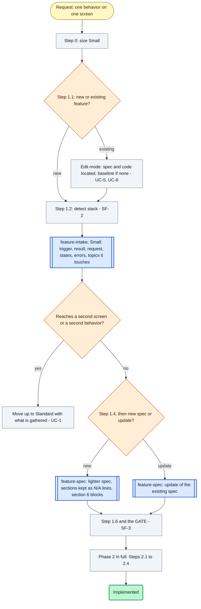

- Small differs from Standard only in Steps 1.3 and 1.5; fields the change doesn't touch say `N/A` (`feature-workflow` "Step 0", "Step 1.3").
- A resumed sheet is sized like a new request, never below Small (`feature-workflow` "Resuming").

### UC-4 — Large feature split into sub-features

Several flows or a new module: one full intake, then sub-features that are each specced, approved and built as Standard.

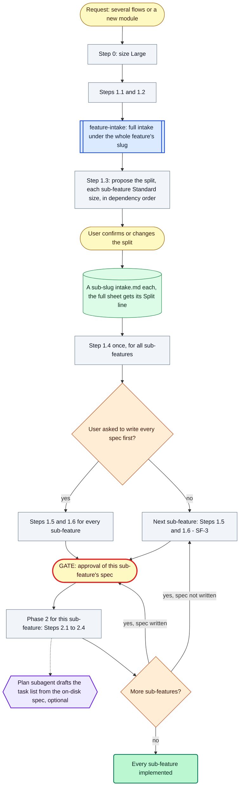

- When unsure between Standard and Large, Step 0 picks Standard, since Step 1.3 can still split after intake (`feature-workflow` "Step 0").
- A Large edit splits too; what the sub-features change on the existing spec's screens goes in their section 3 (`feature-workflow` "Step 1.1", step 4).
- A resume finds the first sub-feature with unfinished work through the `> Split:` line; a sub-feature's sheet stays Standard (`feature-workflow` "Resuming").

---

## Feature workflow — modes and request types

### UC-5 — Edit to a specced feature

A change to a feature the app has and whose spec exists: the deliverable is a delta to that spec.

```mermaid
flowchart TD
  classDef skill fill:#dbeafe,stroke:#1d4ed8,stroke-width:2px,color:#0b1b3f
  classDef agent fill:#ede9fe,stroke:#6d28d9,stroke-width:2px,color:#1e1033
  classDef step fill:#f1f5f9,stroke:#64748b,color:#0f172a
  classDef decision fill:#ffedd5,stroke:#c2410c,color:#431407
  classDef user fill:#fef9c3,stroke:#a16207,color:#422006
  classDef gate fill:#fef9c3,stroke:#dc2626,stroke-width:3px,color:#450a0a
  classDef state fill:#dcfce7,stroke:#15803d,color:#052e16
  classDef done fill:#bbf7d0,stroke:#047857,stroke-width:2px,color:#022c22
  classDef stop fill:#fee2e2,stroke:#b91c1c,stroke-width:2px,color:#450a0a
  E0(["Request: change an existing feature"]):::user
  E1["Step 0: Small, Standard or Large, trivial goes to UC-2"]:::step
  E2["Step 1.1 edit mode: spec via the index, code via enforced anchors"]:::step
  E3{"Spec found?"}:::decision
  E4["Baseline spec first - UC-6"]:::step
  E5{"No row, no anchors, or anchors off the code?"}:::decision
  E6{{"Explore subagent from Code entry points"}}:::agent
  E7["Read the spec and the newest report's deviations and follow-ups"]:::step
  E8{"A Not read item names files the change relies on?"}:::decision
  E9{{"general-purpose subagent: Extending a baseline, baseline.md"}}:::agent
  E10(["User sees what the extension added"]):::user
  E11["Step 1.2: detect stack - SF-2"]:::step
  E12[["feature-intake on the delta: what changes, what stays, regression risk"]]:::skill
  E13{"Section 6 still in bullets?"}:::decision
  E14(["Convert to blocks? recommended, shown as its own change"]):::user
  E15[["feature-spec: update in place, ids kept, new blocks take the next id"]]:::skill
  E16[["feature-spec: update in the bullet format"]]:::skill
  E17[("Index row back to draft")]:::state
  E18["Step 1.6 and the GATE - SF-3"]:::step
  E19[("tasks.md: only the change, each task names the scenarios it adds or alters")]:::state
  E20["Phase 2: rewrite tests of changed scenarios, delete tests of removed blocks"]:::step
  E21["Step 2.3: Conformance judged on the listed scenarios - UC-16"]:::step
  E22["Step 2.4 - UC-17"]:::step
  E23("Implemented"):::done
  E0 --> E1
  E1 --> E2
  E2 --> E3
  E3 -->|no| E4
  E3 -->|yes| E5
  E5 -->|yes| E6
  E5 -->|no| E7
  E6 --> E7
  E7 --> E8
  E8 -->|yes| E9
  E8 -->|no| E11
  E9 --> E10
  E10 --> E11
  E11 --> E12
  E12 --> E13
  E13 -->|yes| E14
  E13 -->|no| E15
  E14 -->|convert| E15
  E14 -->|keep bullets| E16
  E15 --> E17
  E16 --> E17
  E17 --> E18
  E18 --> E19
  E19 --> E20
  E20 --> E21
  E21 --> E22
  E22 --> E23
```

- A change approved while tasks are still unticked adds its tasks to the same file and unticks Spec anchors, Verification and Review (`feature-workflow` "Step 2.2").
- In an edit, a listed scenario whose test this run didn't write or edit is a Conformance finding, since its old test passing says nothing about the change (`feature-workflow` "Step 2.3", Conformance).
- Keeping bullets leaves nothing to anchor: `feature-verify` stops on such a spec and the run's Conformance is skipped (`feature-spec` "When updating an existing spec"; `feature-verify` "Inputs").
- A conversion follows `feature-spec`'s `conversion.md`: the layout brought to the ten sections first, each kind of non-bullet text in its place, and nothing added but what the checker needs and the anchors. A project's freeform feature doc is offered the same conversion at Step 1.4; docs that share a layout of their own keep it (`feature-workflow` "Step 1.4").

### UC-6 — Edit to a never-specced feature: baseline spec

A non-trivial change, bug fix, refactor or missing-tests request on a feature that has no spec yet.

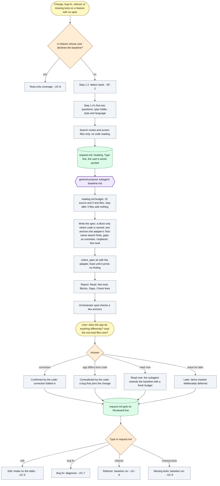

- The reading scope follows the size: a bug fix reads as Small, a refactor or missing-tests request as Standard, so only Standard and Large read the feature's other screens (`feature-workflow` "Request types beside the sizes"; `baseline.md` "Read the code").
- The baseline gets no index row until Step 1.5 saves the change (a missing-tests run: Step 2.4); until then a resume finds it by its baseline items and `request.md` (`feature-workflow` "Resuming", last row).
- The subagent writes only the spec. It runs `check_spec.sh`, which decides quality checks 1 and 6, and fixes each finding until none is left; the open count stays, since the gaps wait for the user's review, and its `Check:` line quotes the `RESULT=` line. A delegated run's `request.md` says `- Asked: see brief.md` (`baseline.md` "Write the spec", "Report"; `feature-workflow` "Step 1.1").
- A `test` anchor names an existing test only when its body checks the scenario, by its description as the test file writes it, so that the adapter's Test-name search finds it; a description with an escape or an interpolation can't be anchored and stays `none` (`baseline.md` "Write the spec"; `feature-spec` "A baseline of existing code").

### UC-7 — Bug fix

The feature does something other than what it should; diagnosed in a subagent, reproduced as a failing test before the fix.

```mermaid
flowchart TD
  classDef skill fill:#dbeafe,stroke:#1d4ed8,stroke-width:2px,color:#0b1b3f
  classDef agent fill:#ede9fe,stroke:#6d28d9,stroke-width:2px,color:#1e1033
  classDef step fill:#f1f5f9,stroke:#64748b,color:#0f172a
  classDef decision fill:#ffedd5,stroke:#c2410c,color:#431407
  classDef user fill:#fef9c3,stroke:#a16207,color:#422006
  classDef gate fill:#fef9c3,stroke:#dc2626,stroke-width:3px,color:#450a0a
  classDef state fill:#dcfce7,stroke:#15803d,color:#052e16
  classDef done fill:#bbf7d0,stroke:#047857,stroke-width:2px,color:#022c22
  classDef stop fill:#fee2e2,stroke:#b91c1c,stroke-width:2px,color:#450a0a
  F0(["Bug report through feature-workflow"]):::user
  F40(["From crash-issue-fixer: a crash fix that changes what a spec states, the verdict and cause handed over, the workflow chosen by name"]):::user
  F1["Step 0: Bug fix type line, never trivial or split"]:::step
  F2{"Behavior the app never had, or wrong copy or token?"}:::decision
  F3["An edit - UC-5, or trivial - UC-2"]:::step
  F4(["Steps, expected, actual, platform or stack trace, one question per turn"]):::user
  F5["Find the spec and blocks by index and anchors, no code reading"]:::step
  F6{"Spec exists?"}:::decision
  F7["Step 1.2, then a baseline spec read as Small - UC-6"]:::step
  F8["Step 1.2 if it hasn't run"]:::step
  F9{{"general-purpose subagent: diagnose.md"}}:::agent
  F10["Trace by reading.md, run the anchored tests, judge the spec"]:::step
  F11{"Cause found?"}:::decision
  F12(["User adds a log, exact steps or the data"]):::user
  F13("Stop: show both diagnoses, change nothing"):::stop
  F14["Check the cause in the code, show the diagnosis"]:::step
  F15{"Spec verdict"}:::decision
  F16[["feature-spec: correct the scenario"]]:::skill
  F17[["feature-spec: add a scenario"]]:::skill
  F18["Scenario text stays as it is"]:::step
  F19["Change record: Bug fix date - title, index row draft"]:::step
  F20["Step 1.6: approval names the scenario, the cause, tests that assert the bug - SF-3"]:::step
  F21(["GATE: approve the spec change"]):::gate
  F22[("tasks.md: Change line, Reproduction test task, Fix task")]:::state
  F23["Step 2.2 baseline"]:::step
  F24{"A host test can reach the bug, and it isn't skipped?"}:::decision
  F25["Write the scenario's test, or rewrite the test that asserts the bug"]:::step
  F26{"Run it"}:::decision
  F27["Fix the test, not the code"]:::step
  F28(["Nothing fixed, task left unticked: the user settles which is wrong"]):::user
  F29[("Reproduction line: command and failing expectation")]:::state
  F30[("Reproduction: manual, what the user saw")]:::state
  F31["Fix only the named cause, the test passes unchanged"]:::step
  F32["The scenario's test anchor names the reproduction test"]:::step
  F33["Steps 2.3 and 2.4 - UC-16, UC-17"]:::step
  F34("Implemented"):::done
  F35["Rewrite the test to the report's path, expectations still the approved THEN line's"]:::step
  F36{{"general-purpose subagent: diagnose.md again, given the test and its output"}}:::agent
  F37{"Second diagnosis"}:::decision
  F38["New cause: correct the change record, and the scenario if it changes, back to Step 1.6"]:::step
  F39("Stop the run: the user no longer sees the bug"):::stop
  F41{"A crash report without steps?"}:::decision
  F42{"Delegated run?"}:::decision
  F43{"crash-issue-fixer skill listed?"}:::decision
  F44(["Hand the report to crash-issue-fixer?"]):::user
  F45[["crash-issue-fixer, sibling plugin: crash triage, this run stops here"]]:::skill
  F46["Name the crash-issue-fixer plugin once, with its install commands"]:::step
  F47(["Ask for the steps that show it"]):::user
  F0 --> F1
  F40 --> F1
  F1 --> F2
  F2 -->|yes| F3
  F2 -->|no| F4
  F4 --> F41
  F41 -->|no, steps given or a cause handed over| F5
  F41 -->|yes| F42
  F42 -->|yes| F47
  F42 -->|no| F43
  F43 -->|yes| F44
  F43 -->|no| F46
  F44 -->|agrees| F45
  F44 -->|declines| F47
  F46 --> F47
  F47 --> F5
  F5 --> F6
  F6 -->|no| F7
  F6 -->|yes| F8
  F7 --> F9
  F8 --> F9
  F9 --> F10
  F10 --> F11
  F11 -->|found| F14
  F11 -->|not found, first try| F12
  F11 -->|not found again| F13
  F12 --> F9
  F14 --> F15
  F15 -->|vague or wrong| F16
  F15 -->|not covered| F17
  F15 -->|states it| F18
  F16 --> F19
  F17 --> F19
  F18 --> F19
  F19 --> F20
  F20 --> F21
  F21 --> F22
  F22 --> F23
  F23 --> F24
  F24 -->|yes| F25
  F24 -->|no| F30
  F25 --> F26
  F26 -->|fails on the broken THEN line| F29
  F26 -->|fails another way| F27
  F26 -->|passes| F28
  F28 -->|the test| F35
  F35 --> F26
  F28 -->|the diagnosis| F36
  F36 --> F37
  F37 -->|new cause| F38
  F38 --> F20
  F37 -->|same cause| F28
  F37 -->|not found| F12
  F28 -->|neither, the user still sees it| F30
  F28 -->|neither, no longer seen| F39
  F27 --> F26
  F29 --> F31
  F30 --> F31
  F31 --> F32
  F32 --> F33
  F33 --> F34
```

- A crash without steps (a Crashlytics issue, a stack trace alone, whether a crash still happens) needs crash triage, which this workflow doesn't do. A crash with steps, or one `crash-issue-fixer` hands over with its verdict and cause, stays here with no hand-off offered: the stack trace or that cause is where the diagnosis starts, and the steps are asked only when the cause alone can't place the reproduction test (`feature-workflow` "Bug fix", Phase 1 step 1).
- The verdict `states it`, `vague`, `wrong` or `not covered` decides the spec change; with `states it` the approval names the scenario the fix restores (`diagnose.md` "Judge the spec"; `feature-workflow` "Bug fix", Phase 1 steps 5-6).
- Rewriting a test that asserted the bug to the approved THEN line follows the spec change and isn't a weakened check (`feature-workflow` "Bug fix", Phase 2 step 4).
- A reproduction test that passes fixes nothing and leaves its task unticked, so a resume starts there again. The test is rewritten when it missed the report's path; a second diagnosis gets the test and its output, and a new cause goes back to Step 1.6, since the change record and the approval named the old one; with neither wrong, the reproduction is manual while the user still sees the bug, the passing test kept as the scenario's test, and otherwise the run stops (`feature-workflow` "Bug fix", Phase 2 step 2; `diagnose.md`).
- The record's label is quoted by `tasks.md`'s `> Change:` line and the run report's heading; compaction keeps the record until a report heading quotes it (`feature-spec` "Change records").

### UC-8 — Refactor, including tests-only coverage

The code changes how it's built and nothing the user sees; pinned by tests and the conformance check before any code moves.

```mermaid
flowchart TD
  classDef skill fill:#dbeafe,stroke:#1d4ed8,stroke-width:2px,color:#0b1b3f
  classDef agent fill:#ede9fe,stroke:#6d28d9,stroke-width:2px,color:#1e1033
  classDef step fill:#f1f5f9,stroke:#64748b,color:#0f172a
  classDef decision fill:#ffedd5,stroke:#c2410c,color:#431407
  classDef user fill:#fef9c3,stroke:#a16207,color:#422006
  classDef gate fill:#fef9c3,stroke:#dc2626,stroke-width:3px,color:#450a0a
  classDef state fill:#dcfce7,stroke:#15803d,color:#052e16
  classDef done fill:#bbf7d0,stroke:#047857,stroke-width:2px,color:#022c22
  classDef stop fill:#fee2e2,stroke:#b91c1c,stroke-width:2px,color:#450a0a
  R0(["Refactor request through feature-workflow"]):::user
  R1["Step 0: Refactor type line, never trivial or split"]:::step
  R2{"Would it change what the user sees?"}:::decision
  R3["An edit - UC-5, or a refactor first and an edit after"]:::step
  R4(["What moves where, the design, why, dependencies added or removed"]):::user
  R5["Find the spec and the blocks whose anchors name the moving code or its callers"]:::step
  R6{"Spec exists?"}:::decision
  R7(["Baseline spec, or tests-only coverage?"]):::user
  R8["Baseline spec read as Standard - UC-6"]:::step
  R9{"Section 6 in bullets?"}:::decision
  R10(["Convert to blocks?"]):::user
  R11["Declined: baseline run is Tests only, Conformance SKIPPED"]:::step
  R12["Baseline run: Tests and Conformance"]:::step
  R13[["feature-verify"]]:::skill
  R14{"Failing test on moving code, or a finding besides no test and moved?"}:::decision
  R15("Stop: fix that first, as a bug fix or an edit"):::stop
  R16(["Pin tests for the test none scenarios, or decline"]):::user
  R17[["feature-spec: design sections only, section 6 untouched, Refactor record"]]:::skill
  R18["Step 1.6: approval names moved blocks, pins, unpinned, dependencies, Conventions departures"]:::step
  R19(["GATE: approve the refactor"]):::gate
  R20{"Departs from the Conventions Report?"}:::decision
  R21[("stack.md Conventions lines updated")]:::state
  R22["The departure is a deviation in the run report"]:::step
  R23[("tasks.md: Change line, pin task, one task per small step")]:::state
  R24["Pin tests on the untouched code"]:::step
  R25{"Pin test result"}:::decision
  R26("Stop: a THEN line fails, report the bug"):::stop
  R27[("Pinned line in tasks.md")]:::state
  R28["Next step: move the code"]:::step
  R29{"Analyze and pinning tests: anything new?"}:::decision
  R30["Fix within the step"]:::step
  R31{"More steps?"}:::decision
  R32["Update every moved anchor, no test expectation edited"]:::step
  R33["Step 2.3: Conformance = baseline findings less those closed - UC-16"]:::step
  R34["Step 2.4 - UC-17"]:::step
  R35("Done"):::done
  R36["Tests-only: Tests check, a refactor plan in one message"]:::step
  R37(["GATE: approve the plan"]):::gate
  R38["Phase 2 without anchors, Conformance or index row, review on conventions and standards"]:::step
  R39["Step 2.2 baseline adds conformance: Phase 1's, or a fresh feature-verify run when Phase 1 ran in another session or the code changed"]:::step
  R0 --> R1
  R1 --> R2
  R2 -->|yes| R3
  R2 -->|no| R4
  R4 --> R5
  R5 --> R6
  R6 -->|no| R7
  R6 -->|yes| R9
  R7 -->|baseline| R8
  R7 -->|tests-only| R36
  R8 --> R12
  R9 -->|yes| R10
  R9 -->|no| R12
  R10 -->|convert| R12
  R10 -->|decline| R11
  R11 --> R14
  R12 -.-> R13
  R12 --> R14
  R14 -->|yes| R15
  R14 -->|no| R16
  R16 --> R17
  R17 --> R18
  R18 --> R19
  R19 --> R20
  R20 -->|yes, project works that way now| R21
  R20 -->|yes, not adopted| R22
  R20 -->|no| R23
  R21 --> R23
  R22 --> R23
  R23 --> R39
  R39 -->|a fresh run finds what stops Phase 1| R15
  R39 --> R24
  R24 --> R25
  R25 -->|fails on a THEN line| R26
  R25 -->|fails another way, fix the test| R24
  R25 -->|passes| R27
  R27 --> R28
  R28 --> R29
  R29 -->|yes| R30
  R30 --> R29
  R29 -->|no| R31
  R31 -->|yes| R28
  R31 -->|no| R32
  R32 --> R33
  R33 --> R34
  R34 --> R35
  R36 --> R37
  R37 --> R38
  R38 --> R35
```

- Conformance passes only with the baseline's findings and no other, less those the run closed; a new finding anywhere fails it (`feature-workflow` "Step 2.3", "In a refactor or a missing-tests run").
- A refactor edits a test only where the code it calls moved or was renamed, never an expectation (`feature-workflow` "Refactor", Phase 2 step 5; `feature-scaffold` "Tests").
- Tests-only coverage keeps its task file and report under a slug named after the moving code, with `> Change: Refactor <date> — <title>` in place of the `Spec` line (`feature-workflow` "Tests-only coverage").

### UC-9 — Missing tests

Adds tests for scenarios the spec already states and no test checks; no code or behavior changes.

```mermaid
flowchart TD
  classDef skill fill:#dbeafe,stroke:#1d4ed8,stroke-width:2px,color:#0b1b3f
  classDef agent fill:#ede9fe,stroke:#6d28d9,stroke-width:2px,color:#1e1033
  classDef step fill:#f1f5f9,stroke:#64748b,color:#0f172a
  classDef decision fill:#ffedd5,stroke:#c2410c,color:#431407
  classDef user fill:#fef9c3,stroke:#a16207,color:#422006
  classDef gate fill:#fef9c3,stroke:#dc2626,stroke-width:3px,color:#450a0a
  classDef state fill:#dcfce7,stroke:#15803d,color:#052e16
  classDef done fill:#bbf7d0,stroke:#047857,stroke-width:2px,color:#022c22
  classDef stop fill:#fee2e2,stroke:#b91c1c,stroke-width:2px,color:#450a0a
  N0(["Add the missing tests for a feature, or feature-verify's offer"]):::user
  N1["Step 0: Missing tests type line, read missing-tests.md"]:::step
  N2["Scope: the feature, and its scenarios when named, another run's unticked tasks finished first"]:::step
  N3{"Spec exists?"}:::decision
  N4["Step 1.2, then a baseline spec read as Standard - UC-6"]:::step
  N5{"Section 6 in bullets?"}:::decision
  N6(["Convert to blocks?"]):::user
  N7("Stop: nothing to anchor a test to"):::stop
  N8["Baseline run: Conformance and Tests"]:::step
  N9[["feature-verify"]]:::skill
  N10["Candidates: the no test and test missing findings"]:::step
  N11["Named and left: failing, unimplemented, not anchored"]:::step
  N12["Plan in one message: scenarios by regression cost, files, layers, moved anchors, left out"]:::step
  N13(["GATE: approve the plan, any part of it, or none"]):::gate
  N14[("tasks.md: Change Missing tests line, a task per test file")]:::state
  N15["Write a test from the THEN and AND lines, run it"]:::step
  N16{"On the code as it is"}:::decision
  N17["Fix the test without changing what it checks"]:::step
  N18["Scenario leaves the plan, may become a bug fix - UC-7"]:::step
  N19["Tick the task with its result"]:::step
  N20{"More planned tests?"}:::decision
  N21["Anchors, moved anchors, the Test plan line, nothing else"]:::step
  N22["Step 2.3: Conformance = baseline less those closed - UC-16"]:::step
  N23["Step 2.4: a finding that needs a code fix is a follow-up - UC-17"]:::step
  N24[("Index row keeps its status, only Last verified copied, a baseline spec's row added as implemented")]:::state
  N25("Done"):::done
  N26["Step 2.2 baseline adds conformance: Phase 1's, or a fresh feature-verify run"]:::step
  N27("No part taken: nothing written"):::done
  N0 --> N1
  N1 --> N2
  N2 --> N3
  N3 -->|no| N4
  N3 -->|yes| N5
  N4 --> N8
  N5 -->|yes| N6
  N5 -->|no| N8
  N6 -->|decline| N7
  N6 -->|convert| N8
  N8 -.-> N9
  N8 --> N10
  N10 --> N11
  N11 --> N12
  N12 --> N13
  N13 -->|all or part| N14
  N13 -->|none| N27
  N14 --> N26
  N26 --> N15
  N15 --> N16
  N16 -->|passes| N19
  N16 -->|fails another way| N17
  N16 -->|fails on a THEN line| N18
  N17 --> N15
  N18 --> N20
  N19 --> N20
  N20 -->|yes| N15
  N20 -->|no| N21
  N21 --> N22
  N22 --> N23
  N23 --> N24
  N24 --> N25
```

- Only the host-test folder, the spec's anchors and Test plan line, and a new test file's registration are written; a scenario no test can reach without a code change is left out, named as a refactor (`missing-tests.md` Phase 1 step 4, Phase 2 step 4).
- A scenario the user drops or skips during the run leaves the plan the same way and goes under Follow-ups (`missing-tests.md` Phase 2 step 3; `feature-workflow` "Step 2.3").
- Index row: Step 2.4 keeps its status, since an `approved` or `draft` row stands for a change not built yet, and copies only the spec's `Last verified` line; a baseline spec without a row gets one at `implemented` (`missing-tests.md` last paragraph; `feature-workflow` "Spec index", Step 2.4).
- Another run's unticked tasks are finished first, since this run's tasks replace `tasks.md`. Resumed, the run goes to its first unticked task even beside a change not built yet, whose blocks no task names (`missing-tests.md` step 1; `feature-workflow` "Resuming").

### UC-10 — Skipped tests

The user puts delivery first and skips some scenarios' tests, before approval or during Phase 2.

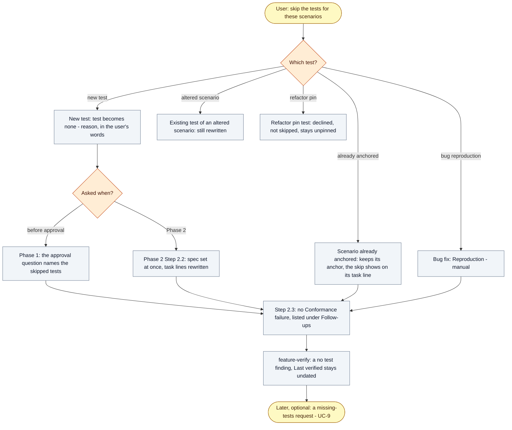

- Only a new test can be skipped; an existing test of an altered scenario would fail otherwise (`feature-workflow` "Step 2.2", Skipped tests).
- `none — <reason>` stays until a test covers the scenario; only a test closes the finding (`feature-spec` "Section 6", Skipped tests; `feature-verify` "The check" step 3).

### UC-11 — Resuming an unfinished run

Re-invoking the workflow on a feature with state, or a bare "continue"; the first matching row of the Resuming table wins.

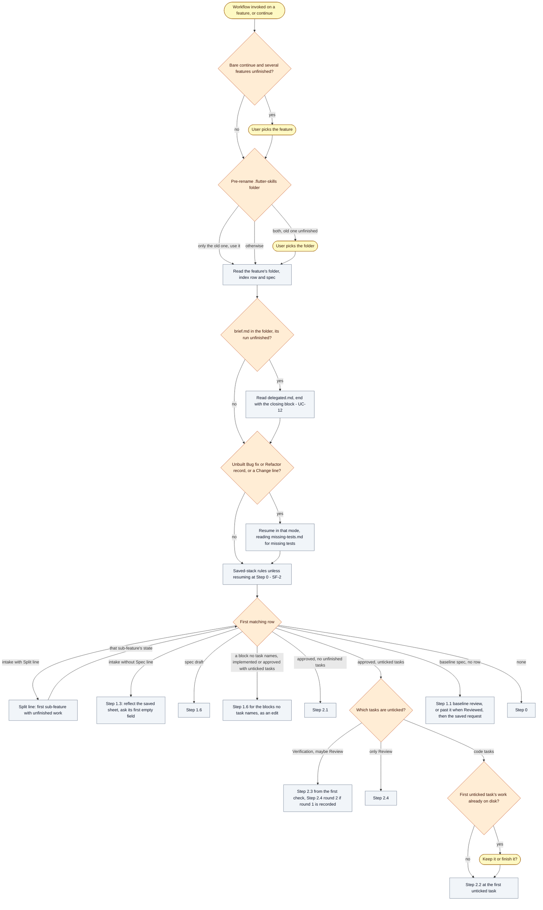

- A `draft` spec always resumes at Step 1.6, whatever `tasks.md` holds, so it never resumes into Phase 2 (`feature-workflow` "Resuming").
- A new change to a feature with unfinished work asks first whether to finish that work (`feature-workflow` "Resuming").
- A refactor with tests-only coverage and a missing-tests run take their `tasks.md` as an `approved` spec's. Blocks still at `enforced: (filled in Phase 2)` beside a missing-tests run belong to a change not built yet, so they don't send it to Step 1.6 (`feature-workflow` "Resuming", mode bullet).
- A bug fix whose reproduction test passed left that task unticked, so it resumes there (`feature-workflow` "Bug fix", Phase 2 step 2).

### UC-12 — Delegated run from a monorepo parent

A project's own cross-part workflow hands the app's part to `feature-workflow` with a delegation brief; the user never types one.

```mermaid
flowchart TD
  classDef skill fill:#dbeafe,stroke:#1d4ed8,stroke-width:2px,color:#0b1b3f
  classDef agent fill:#ede9fe,stroke:#6d28d9,stroke-width:2px,color:#1e1033
  classDef step fill:#f1f5f9,stroke:#64748b,color:#0f172a
  classDef decision fill:#ffedd5,stroke:#c2410c,color:#431407
  classDef user fill:#fef9c3,stroke:#a16207,color:#422006
  classDef gate fill:#fef9c3,stroke:#dc2626,stroke-width:3px,color:#450a0a
  classDef state fill:#dcfce7,stroke:#15803d,color:#052e16
  classDef done fill:#bbf7d0,stroke:#047857,stroke-width:2px,color:#022c22
  classDef stop fill:#fee2e2,stroke:#b91c1c,stroke-width:2px,color:#450a0a
  D0["Parent: the project's own cross-part workflow skill"]:::step
  D1["Invokes feature-workflow with a Delegation brief"]:::step
  D2["Read delegated.md before Step 0"]:::step
  D3{"Adapter finds App, Specs sit inside it, Request one of its four values, every line present?"}:::decision
  D4("Stop: say what doesn't match, write nothing"):::stop
  D5(["Ask once for the missing line"]):::user
  D6[("brief.md in each state folder before any other file: the Slug's for a new feature, the changed app spec's slug otherwise")]:::state
  D7["Step 0 sizes the app slice alone, never trivial"]:::step
  D8{"Request line"}:::decision
  D9[("Slice saved as intake.md, other parts out of scope")]:::state
  D10[["feature-intake asks only what the slice leaves open"]]:::skill
  D11["Bug fix or refactor mode, the slice as its report or plan - UC-7, UC-8"]:::step
  D12["Phase 1: brief's Specs folder, contract shapes in section 4 under a Contract line"]:::step
  D13{"API contract draft?"}:::decision
  D14["Its shapes are PROVISIONAL - UC-15"]:::step
  D15{"Approval line"}:::decision
  D16["Step 1.6 as written - SF-3"]:::step
  D17(["GATE: the user approves here"]):::gate
  D18("Closing block, Stage awaiting approval"):::done
  D19["Parent gets every part's spec approved, invokes again"]:::step
  D20{"A draft contract approved since?"}:::decision
  D21["Shapes confirmed in the spec, quality check, approval asked here"]:::step
  D22{"An explicit user message names this spec file, after its last change?"}:::decision
  D23["Phase 2 for the app alone, cross-part checks as manual follow-ups"]:::step
  D24("Closing block: Handoff - slug, Spec, Stage, Verification, Review, Report, Follow-ups"):::done
  D0 --> D1
  D1 --> D2
  D2 --> D3
  D3 -->|no| D4
  D3 -->|a line missing| D5
  D5 --> D3
  D3 -->|yes| D6
  D6 --> D7
  D7 --> D8
  D8 -->|new feature or change| D9
  D8 -->|bug fix or refactor| D11
  D9 --> D10
  D10 --> D12
  D11 --> D12
  D12 --> D13
  D13 -->|draft| D14
  D13 -->|approved or none| D15
  D14 --> D15
  D15 -->|here| D16
  D15 -->|with the other parts| D18
  D16 --> D17
  D17 --> D23
  D18 -.->|later| D19
  D19 --> D20
  D20 -->|yes| D21
  D20 -->|no| D22
  D21 --> D17
  D22 -->|yes| D23
  D22 -->|no| D17
  D23 -->|implemented, or a FAIL stops the run| D24
```

- `Request` is `new feature`, `change`, `bug fix` or `refactor`. A missing-tests request isn't delegated: it adds the app's tests and nothing another part depends on, so the user asks for it directly (UC-9), and a brief with any other value stops at the brief check (`delegated.md` "Request" and step 1).
- A brief that comes back with the same `Slug` replaces the saved copies; once the run's specs are `implemented`, a request without a new brief is a direct one (`delegated.md` step 3).
- A Large slice splits as Step 1.3 says; with `Approval: with the other parts`, every sub-feature's spec is written before the hand-back (`delegated.md` step 4).
- Nothing outside the project root is written; the parent updates the other parts and the root directory from the closing block (`delegated.md` steps 8-9).
- A delegated bug fix offers no `crash-issue-fixer` hand-off: a crash report without steps gets its steps asked for (`feature-workflow` "Bug fix", Phase 1 step 1; UC-7).

### UC-13 — Cross-part request without a brief

A direct request in a monorepo app that also needs work another part owns, such as a missing endpoint or a web page.

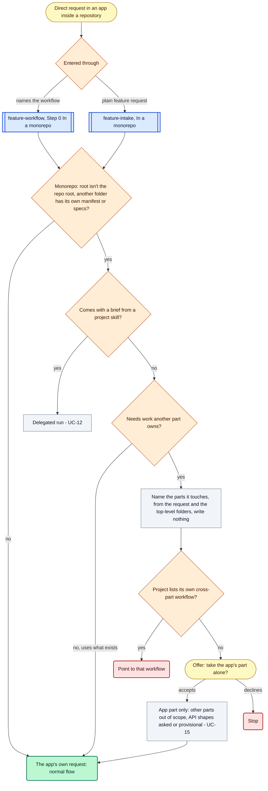

- A brief the model writes itself for a direct request isn't one; that request goes by Step 0's "In a monorepo" (`feature-workflow` "Delegated runs"; `delegated.md`).
- One app in a subfolder beside docs, design or CI files isn't a monorepo (`feature-workflow` "State files", Monorepo).

### UC-14 — Hybrid native code

A Flutter feature that needs Swift or Kotlin code, a permission or a capability; the SwiftUI adapter is the native adapter for `ios`, the Compose adapter for `android`.

```mermaid
flowchart TD
  classDef skill fill:#dbeafe,stroke:#1d4ed8,stroke-width:2px,color:#0b1b3f
  classDef agent fill:#ede9fe,stroke:#6d28d9,stroke-width:2px,color:#1e1033
  classDef step fill:#f1f5f9,stroke:#64748b,color:#0f172a
  classDef decision fill:#ffedd5,stroke:#c2410c,color:#431407
  classDef user fill:#fef9c3,stroke:#a16207,color:#422006
  classDef gate fill:#fef9c3,stroke:#dc2626,stroke-width:3px,color:#450a0a
  classDef state fill:#dcfce7,stroke:#15803d,color:#052e16
  classDef done fill:#bbf7d0,stroke:#047857,stroke-width:2px,color:#022c22
  classDef stop fill:#fee2e2,stroke:#b91c1c,stroke-width:2px,color:#450a0a
  H0["Approved Flutter spec, section 4 lists native interfaces, permissions or capabilities"]:::step
  H1["Read the Flutter adapter's Native interop, grep the adapters for Native adapter for"]:::step
  H2{"Native platform"}:::decision
  H3["ios: the SwiftUI adapter is its native adapter, adds its rules for every Swift file, its agents, and its test rules and commands for native unit tests in RunnerTests"]:::step
  H4["android: the Compose adapter is its native adapter, adds its rules for every Kotlin file, its agents, and its test rules and commands for native unit tests in android/app/src/test"]:::step
  H20(["macos, web, windows or linux folder: not covered, ask before writing native code there"]):::user
  H5[("tasks.md names native and declaration files per platform, the Standards line each native adapter's file")]:::state
  H6["Step 2.2 baseline: Native build per platform folder the tasks name"]:::step
  H7{"Baseline native build fails?"}:::decision
  H8(["Shown to the user before any native file is written"]):::user
  H9[["feature-scaffold: Dart interface, Pigeon or channel, native side, Info.plist and AndroidManifest declarations, usage keys"]]:::skill
  H10["Step 2.3 Native build: flutter build ios simulator debug, flutter build apk debug, with the development flavor and entry point"]:::step
  H11{"Native build after two failed fixes"}:::decision
  H12{{"swift-build-resolver, once"}}:::agent
  H13{{"kotlin-build-resolver, once"}}:::agent
  H21{"The orchestrator's rerun passes?"}:::decision
  H22("Stop: later checks NOT RUN, report written, user sees the output - UC-16"):::stop
  H14["Step 2.4 native pass per platform, given only that platform's native files in its adapter's language, other languages NOT RUN - no reviewer"]:::step
  H15{{"swift-reviewer on the ios Swift files"}}:::agent
  H16{{"kotlin-reviewer on the android Kotlin files"}}:::agent
  H17{{"security-reviewer: a permission or declaration was added"}}:::agent
  H18["Closing notes: device check per native method and prompt, account capabilities"]:::step
  H19("Done"):::done
  H0 --> H1
  H1 --> H2
  H2 -->|ios| H3
  H2 -->|android| H4
  H2 -->|another folder| H20
  H3 --> H5
  H4 --> H5
  H20 -->|user agrees, no native adapter| H5
  H5 --> H6
  H6 --> H7
  H7 -->|yes| H8
  H7 -->|no| H9
  H8 --> H9
  H9 --> H10
  H10 --> H11
  H11 -->|passes| H14
  H11 -->|ios fails| H12
  H11 -->|android fails| H13
  H12 -->|rerun the check| H21
  H13 -->|rerun the check| H21
  H21 -->|yes| H14
  H21 -->|no| H22
  H14 -->|ios files| H15
  H14 -->|android files| H16
  H14 -->|triggers met| H17
  H15 --> H18
  H16 --> H18
  H17 --> H18
  H18 --> H19
```

- Each new iOS usage key also goes into `REQUIRED_USAGE_KEYS` of the project's `scripts/build-version.sh`, which `mobile-build-deploy` checks before every iOS build (flutter `PLATFORM.md` "Native interop", Declarations; UC-23).
- A platform the machine can't build becomes a manual check (`ios/` builds only where `xcodebuild -version` succeeds); with neither left, Native build is `SKIPPED` (flutter `PLATFORM.md` "Commands").
- Native logic that must run without the Flutter engine gets native unit tests (the Test plan's `Native unit` line), run in the Tests check and by `feature-verify` with the native adapter's commands; a platform whose native command rule stops on this machine goes on the manual checks, and `feature-verify` lists its anchored tests on its `Not run:` line, which leaves `Last verified` undated (flutter `PLATFORM.md` "Commands", "Native interop"; `feature-verify` step 4).
- In `ios/` and `android/`, the native reviewers judge channel and plugin code by their language, concurrency, platform and security items; SwiftUI view patterns, and Compose's architecture and Compose items, don't apply. Generated Pigeon output, Objective-C and Java files are out of their scope (`swift-reviewer`, `kotlin-reviewer` "Inputs from feature-workflow").
- A Native pass gets only the files in its adapter's language, the Swift or Kotlin files its `Native adapter for:` line names; native files in another language follow the project's own native files and the common standards, with no native review, and Step 2.4 records `NOT RUN — no reviewer for <language> files` (`feature-workflow` "Native adapters", "Step 2.4").
- A folder with no native adapter gets neither a native pass nor a native build fixer (`feature-workflow` "Native adapters").
- A native SwiftUI or Compose app uses its own adapter: its native code is the app's own, reviewed by the platform pass, and Native build is `none`, since Analyze already builds everything (swiftui and compose `PLATFORM.md` "Native interop", "Commands").

### UC-15 — Provisional API shapes

The one exception to "never invent": the user says the backend isn't ready, or a brief's API contract is a `draft` spec.

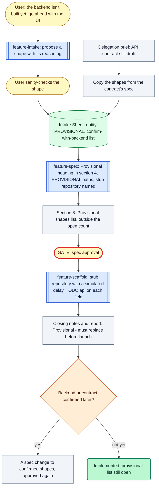

- A TBD blocks until resolved; a provisional shape unblocks the UI and is a debt listed for launch (`feature-spec` "When the API is explicitly not ready yet").
- A draft contract's endpoints keep the contract's path beside `PROVISIONAL`, and the section 8 list names that spec (`feature-spec` "API contract from another part").

---

## Feature workflow — Phase 2 internals

### UC-16 — Verification run, FAIL and build fixer

`feature-workflow` Step 2.3, once the spec anchors are filled; the same checks run in the scaffold's Step 5 outside the orchestrator.

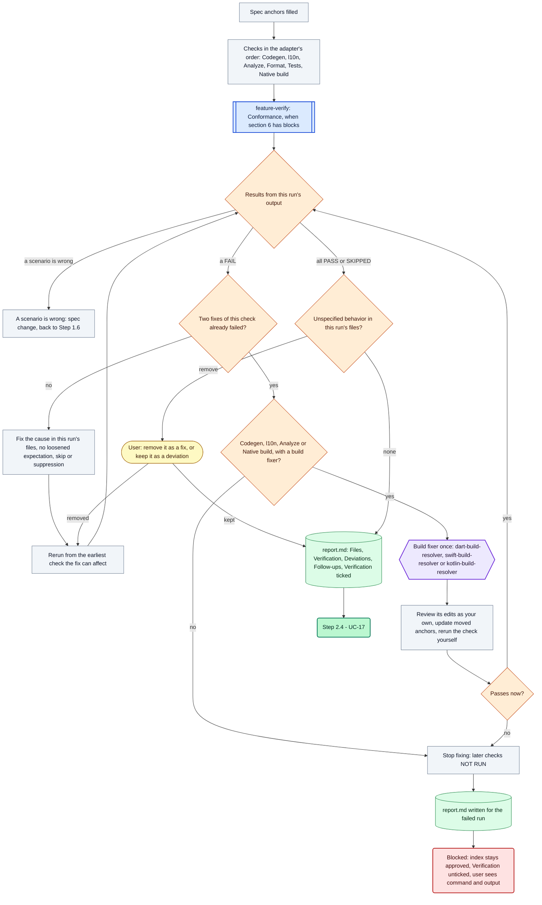

- Analyze, Format and Tests pass when nothing is new against `tasks.md`'s `> Baseline:` line; a check that applies but couldn't run is a `FAIL`, and `SKIPPED` only means it doesn't apply (`feature-workflow` "Step 2.3", Results and Against the baseline).
- Conformance fails only on what this run built; older gaps, deferred TBDs and skipped tests go under Follow-ups (refactor and missing-tests runs: UC-8, UC-9) (`feature-workflow` "Step 2.3", Conformance).
- The build fixer is the adapter's for Codegen, l10n and Analyze: `dart-build-resolver` in a Flutter app, `swift-build-resolver` in a SwiftUI app, `kotlin-build-resolver` in a Compose app. For a Flutter run's Native build it is the native adapter's: `swift-build-resolver` for `ios/`, `kotlin-build-resolver` for `android/` (each adapter's "Agents"; `feature-workflow` "Step 2.3"; UC-14).
- The build fixer edits only the run's files; anything else it proposes, such as a dependency change, goes to the user (`feature-workflow` "Step 2.3", build fixer; `dart-build-resolver`, `swift-build-resolver`, `kotlin-build-resolver` "Inputs from feature-workflow").
- A check an adapter has no command for is `none` and ends `SKIPPED`: Compose's Codegen, l10n and Native build, whose work runs inside its Analyze compile, and SwiftUI's l10n and Native build (each adapter's "Commands").
- The trivial path runs these checks without the build fixer (UC-2).

### UC-17 — Review and its fix loop

`feature-workflow` Step 2.4, after a passing verification run; fresh subagents report, the orchestrator settles.

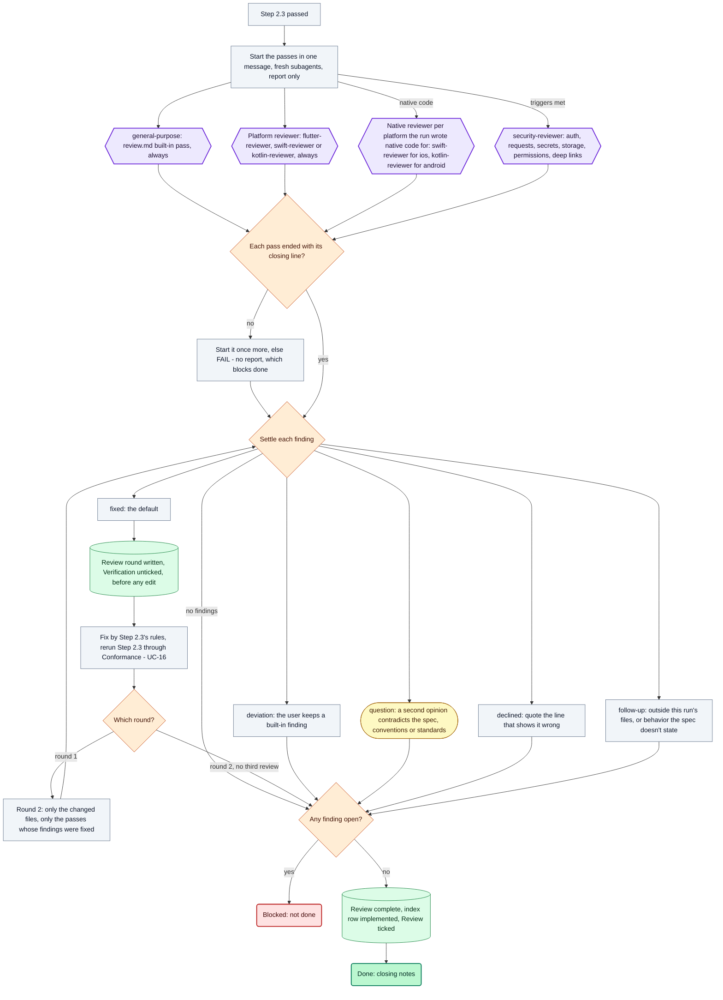

- A CRITICAL or HIGH finding is declined or left as a follow-up only with the user's agreement, and its question stays open until answered (`feature-workflow` "Step 2.4", Settle).
- When the platform reviewer names `security-reviewer` and the security pass was skipped, it runs on the files that finding names; a reviewer that isn't installed, an adapter with `none`, or native files in a language their native adapter doesn't cover is `NOT RUN` and doesn't block (`feature-workflow` "Step 2.4", Pass results).
- The closing lines quoted in `### Review`: the built-in pass's `Built-in review: …`, each platform or native reviewer's `Verdict: …` line, `security-reviewer`'s count per severity (`review.md` "Report"; each adapter's "Agents").
- In a missing-tests run, any finding whose fix would change code is a follow-up; with tests-only coverage the built-in pass runs checks 1, 2 and 5 against the plan (`feature-workflow` "Step 2.4"; `review.md` check 5).

---

## Feature skills on their own

### UC-18 — `feature-intake` on its own

A feature description or requirements dump that doesn't name the workflow; the model invokes intake, not the orchestrator.

```mermaid
flowchart TD
  classDef skill fill:#dbeafe,stroke:#1d4ed8,stroke-width:2px,color:#0b1b3f
  classDef agent fill:#ede9fe,stroke:#6d28d9,stroke-width:2px,color:#1e1033
  classDef step fill:#f1f5f9,stroke:#64748b,color:#0f172a
  classDef decision fill:#ffedd5,stroke:#c2410c,color:#431407
  classDef user fill:#fef9c3,stroke:#a16207,color:#422006
  classDef gate fill:#fef9c3,stroke:#dc2626,stroke-width:3px,color:#450a0a
  classDef state fill:#dcfce7,stroke:#15803d,color:#052e16
  classDef done fill:#bbf7d0,stroke:#047857,stroke-width:2px,color:#022c22
  classDef stop fill:#fee2e2,stroke:#b91c1c,stroke-width:2px,color:#450a0a
  I0(["User describes a feature or pastes a requirements dump"]):::user
  I1[["feature-intake"]]:::skill
  I2{"Monorepo request that needs another part?"}:::decision
  I3["Cross-part handling - UC-13"]:::step
  I4["List saved sheets, one Saved sheets line"]:::step
  I5{"Saved sheet for this feature?"}:::decision
  I6["Resume the unfinished sheet: reflect back, ask its first empty field"]:::step
  I7(["Maybe the same feature: resume, or a new slug?"]):::user
  I8["New sheet, slug chosen once"]:::step
  I9{"Dump or short description?"}:::decision
  I10["Read it all, extract, reflect 5-8 bullets, list gaps, ask the top gap"]:::step
  I11["Ask Summary and Routes, then section by section"]:::step
  I12(["User answers, one question per turn"]):::user
  I13[("intake.md updated in the same turn")]:::state
  I14["Probe states, API errors, permissions, then the relevant non-functional topics"]:::step
  I15{"All six sections concrete or N/A, or TBDs the user deferred?"}:::decision
  I16[["feature-spec - UC-19"]]:::skill
  I17{"Invoked by feature-workflow?"}:::decision
  I18("Back to feature-workflow: Step 1.4 before the spec - UC-1"):::done
  I19{"Figma frame links given?"}:::decision
  I20{"No tool reads Figma, Claude-in-Chrome tools there, figma-design-to-artifact listed?"}:::decision
  I21(["Offer: export the frames with figma-design-to-artifact?"]):::user
  I22[["figma-design-to-artifact, sibling plugin"]]:::skill
  I23[("figma/ in the feature's state folder, Figma references name the exports beside the links")]:::state
  I0 --> I1
  I1 --> I2
  I2 -->|yes| I3
  I2 -->|no| I4
  I4 --> I5
  I5 -->|unfinished, same feature| I6
  I5 -->|unclear| I7
  I5 -->|finished or none| I8
  I7 -->|resume| I6
  I7 -->|new| I8
  I6 --> I12
  I8 --> I9
  I9 -->|dump| I10
  I9 -->|short| I11
  I10 --> I12
  I11 --> I12
  I12 --> I13
  I13 --> I19
  I19 -->|no| I14
  I19 -->|yes| I20
  I20 -->|no, nothing said| I14
  I20 -->|yes| I21
  I21 -->|yes| I22
  I21 -->|no| I14
  I22 --> I23
  I23 --> I14
  I14 --> I15
  I15 -->|no| I12
  I15 -->|yes| I17
  I17 -->|no| I16
  I17 -->|yes| I18
```

- `feature-workflow`'s description sends requests that don't name it here; it starts only when named or delegated (`feature-workflow` frontmatter and intro).
- A sheet with a `> Spec:` or `> Split:` first line is finished: a later change starts a new sheet in its place (`feature-intake` "Saving the sheet").
- When `feature-workflow` invokes intake, it is Step 1.3: the finished sheet goes back to the orchestrator, never straight to `feature-spec`, since Step 1.4 comes before the spec (`feature-intake` "When intake is done"; `feature-workflow` "Step 1.3").
- The Figma export is offered only when no tool in the session reads Figma files directly, the Claude-in-Chrome tools are there and a `figma-design-to-artifact` skill is listed, and it runs only after the user's yes; without that skill nothing is said and the links stay as given. The same offer comes up when intake runs inside the workflow (`feature-intake` "General rules during intake", Figma last; `feature-workflow` "State files").

### UC-19 — `feature-spec` on its own

"Write the spec" once an Intake Sheet is populated, outside the orchestrator.

```mermaid
flowchart TD
  classDef skill fill:#dbeafe,stroke:#1d4ed8,stroke-width:2px,color:#0b1b3f
  classDef agent fill:#ede9fe,stroke:#6d28d9,stroke-width:2px,color:#1e1033
  classDef step fill:#f1f5f9,stroke:#64748b,color:#0f172a
  classDef decision fill:#ffedd5,stroke:#c2410c,color:#431407
  classDef user fill:#fef9c3,stroke:#a16207,color:#422006
  classDef gate fill:#fef9c3,stroke:#dc2626,stroke-width:3px,color:#450a0a
  classDef state fill:#dcfce7,stroke:#15803d,color:#052e16
  classDef done fill:#bbf7d0,stroke:#047857,stroke-width:2px,color:#022c22
  classDef stop fill:#fee2e2,stroke:#b91c1c,stroke-width:2px,color:#450a0a
  S0(["Write the spec, with a populated Intake Sheet"]):::user
  S1[["feature-spec"]]:::skill
  S2["Adapter: Stack layer and Spec notation, the Test-name search for anchors to existing tests - SF-1"]:::step
  S3{"New spec or update?"}:::decision
  S4{"Genuinely small?"}:::decision
  S5["Ten-section template, section 6 blocks, Test plan"]:::step
  S6["Lighter spec: structure kept with N/A lines, blocks still used"]:::step
  S7{"Section 6 in bullets?"}:::decision
  S8(["Convert to blocks? recommended"]):::user
  S9["Edit in place, ids never renumbered, a conversion anchoring the existing tests the Test-name search finds, or bullets if declined"]:::step
  S10[("Saved in the caller's folder, else the project root: a new spec as slug-feature-spec.md unless the caller names another, an update in its own file, intake.md Spec line")]:::state
  S11["Quality check: check_spec.sh, then checks 2-5 and 7"]:::step
  S12{"Findings"}:::decision
  S13["Fix in place, run the script again"]:::step
  S14["Others become section 8 TBDs"]:::step
  S15["Show the Open Questions, manual and skipped tests"]:::step
  S16(["GATE: Approve this spec?"]):::gate
  S17{"Reply"}:::decision
  S18(["Just to confirm, proceed with code generation?"]):::user
  S19[["feature-scaffold - UC-20"]]:::skill
  S0 --> S1
  S1 --> S2
  S2 --> S3
  S3 -->|new| S4
  S3 -->|update| S7
  S4 -->|yes| S6
  S4 -->|no| S5
  S5 --> S10
  S6 --> S10
  S7 -->|yes| S8
  S7 -->|no| S9
  S8 --> S9
  S9 --> S10
  S10 --> S11
  S11 --> S12
  S12 -->|mechanical| S13
  S13 --> S11
  S12 -->|needs an answer| S14
  S12 -->|none| S15
  S14 --> S15
  S15 --> S16
  S16 --> S17
  S17 -->|approved| S19
  S17 -->|ok alone| S18
  S18 --> S17
  S17 -->|changes| S11
```

- On its own the Handoff runs steps 1-5; inside `feature-workflow` it stops after the save and Step 1.6 takes over (`feature-spec` "Handoff"; `feature-workflow` "Step 1.5").
- On its own there is no TBD loop and no `open=0` condition before the question, and no index row is written (`feature-spec` "Handoff"; compare `feature-workflow` "Step 1.6").
- A new spec's file is `<feature-slug>-feature-spec.md`, with the slug of its requirement ids, unless the caller names another; an update keeps its file (`feature-spec` "The output template").

### UC-20 — `feature-scaffold` on its own

"Build it" or "scaffold the code" after a spec was approved outside the orchestrator.

```mermaid
flowchart TD
  classDef skill fill:#dbeafe,stroke:#1d4ed8,stroke-width:2px,color:#0b1b3f
  classDef agent fill:#ede9fe,stroke:#6d28d9,stroke-width:2px,color:#1e1033
  classDef step fill:#f1f5f9,stroke:#64748b,color:#0f172a
  classDef decision fill:#ffedd5,stroke:#c2410c,color:#431407
  classDef user fill:#fef9c3,stroke:#a16207,color:#422006
  classDef gate fill:#fef9c3,stroke:#dc2626,stroke-width:3px,color:#450a0a
  classDef state fill:#dcfce7,stroke:#15803d,color:#052e16
  classDef done fill:#bbf7d0,stroke:#047857,stroke-width:2px,color:#022c22
  classDef stop fill:#fee2e2,stroke:#b91c1c,stroke-width:2px,color:#450a0a
  Z0(["Build it, or scaffold the code, after approval"]):::user
  Z1[["feature-scaffold"]]:::skill
  Z2["Adapter lookup - SF-1"]:::step
  Z3["Step 1: saved stack, detection, command - SF-2"]:::step
  Z4{"Conventions saved under a matching fingerprint?"}:::decision
  Z5(["User confirms the Detected Stack and Conventions Report"]):::user
  Z6[("stack.md with conventions")]:::state
  Z7["Step 2: load the standards files, a native adapter's for native code, Standards line"]:::step
  Z8["Baseline: Analyze, Tests, Native build on untouched code"]:::step
  Z9{"Pattern source for this file kind"}:::decision
  Z10["Mirror the project's exemplar"]:::step
  Z11["The adapter's template set, as a starting point"]:::step
  Z12(["Neither: from scratch, switch the stack, or hold off"]):::user
  Z13["Generate file by file in the Generation order, layer tests right after"]:::step
  Z14{"Gap?"}:::decision
  Z15(["Ask: state behavior, a default per gap, new dependency, overwrite"]):::user
  Z16["Spec TBD: TODO spec comment, listed in the closing notes"]:::step
  Z17["Fill the spec anchors and the Last verified line"]:::step
  Z18["Step 5: checks in order, then feature-verify"]:::step
  Z19{"Any FAIL?"}:::decision
  Z20["Fix this run's files, no weakening, rerun"]:::step
  Z21("Closing notes: manual checks, TBDs, anchors, defaults"):::done
  Z22("Hold off: that file kind waits for a template set"):::stop
  Z0 --> Z1
  Z1 --> Z2
  Z2 --> Z3
  Z3 --> Z4
  Z4 -->|yes| Z7
  Z4 -->|no| Z5
  Z5 --> Z6
  Z6 --> Z7
  Z7 --> Z8
  Z8 --> Z9
  Z9 -->|an exemplar exists| Z10
  Z9 -->|the stack has a template set| Z11
  Z9 -->|neither| Z12
  Z10 --> Z13
  Z11 --> Z13
  Z12 -->|from scratch, or switch the stack| Z13
  Z12 -->|hold off| Z22
  Z13 --> Z14
  Z14 -->|needs the user| Z15
  Z15 --> Z13
  Z14 -->|spec TBD| Z16
  Z16 --> Z13
  Z14 -->|none, every file written| Z17
  Z17 --> Z18
  Z18 --> Z19
  Z19 -->|yes| Z20
  Z20 --> Z18
  Z19 -->|no| Z21
```

- On its own there is no `tasks.md`, run report, review, index row or build fixer; inside `feature-workflow` Step 5's checks are skipped and the orchestrator runs them (`feature-scaffold` "Step 5").
- "Just build it, fill the gaps" gets a list of gaps with a proposed default each, confirmed before that part is generated (`feature-scaffold` "When the spec has gaps").
- A standard wins over an exemplar, and a project rule over a bundled rule it names (`feature-scaffold` "Step 2").

### UC-21 — `feature-verify` on its own

"Does the code match the spec?" for any spec whose section 6 has blocks; it reports and fixes nothing.

```mermaid
flowchart TD
  classDef skill fill:#dbeafe,stroke:#1d4ed8,stroke-width:2px,color:#0b1b3f
  classDef agent fill:#ede9fe,stroke:#6d28d9,stroke-width:2px,color:#1e1033
  classDef step fill:#f1f5f9,stroke:#64748b,color:#0f172a
  classDef decision fill:#ffedd5,stroke:#c2410c,color:#431407
  classDef user fill:#fef9c3,stroke:#a16207,color:#422006
  classDef gate fill:#fef9c3,stroke:#dc2626,stroke-width:3px,color:#450a0a
  classDef state fill:#dcfce7,stroke:#15803d,color:#052e16
  classDef done fill:#bbf7d0,stroke:#047857,stroke-width:2px,color:#022c22
  classDef stop fill:#fee2e2,stroke:#b91c1c,stroke-width:2px,color:#450a0a
  CV0(["Does the code match the spec, or verify the saved-articles spec"]):::user
  CV1[["feature-verify"]]:::skill
  CV2["Adapter: Project layout and Commands - SF-1"]:::step
  CV3{"A path, or one index match?"}:::decision
  CV4(["No match or several: which spec?"]):::user
  CV5["Command: the caller's, else a matching stack.md Command line, else the rule"]:::step
  CV6{"Section 6 in bullets?"}:::decision
  CV7("Stop: nothing to check, feature-spec can convert it"):::stop
  CV8["List the blocks with grep, from the file"]:::step
  CV9["enforced anchors: not anchored, moved, unimplemented"]:::step
  CV10["test anchors through the adapter's Test-name search: test missing, no test, the manual list"]:::step
  CV11["Run the anchored tests with the adapter's anchored-test command, in one run: failing, test missing"]:::step
  CV12["Unspecified behavior in the anchored files: listed, not a finding"]:::step
  CV13["Report: Conformance PASS or FAIL, what would close each finding"]:::step
  CV14{"Full pass?"}:::decision
  CV15{"Index row draft, or told to report only?"}:::decision
  CV16[("Last verified: date and commit, copied to the index cell")]:::state
  CV17["Line left as it is, or returned to the caller"]:::step
  CV18{"Asked directly, with no test or test missing findings?"}:::decision
  CV19(["Offer once: a missing-tests request - UC-9"]):::user
  CV20("Done, nothing fixed"):::done
  CV0 --> CV1
  CV1 --> CV2
  CV2 --> CV3
  CV3 -->|no| CV4
  CV3 -->|yes| CV5
  CV4 --> CV5
  CV5 --> CV6
  CV6 -->|yes| CV7
  CV6 -->|no| CV8
  CV8 --> CV9
  CV9 --> CV10
  CV10 --> CV11
  CV11 --> CV12
  CV12 --> CV13
  CV13 --> CV14
  CV14 -->|yes| CV15
  CV14 -->|no| CV17
  CV15 -->|no| CV16
  CV15 -->|yes| CV17
  CV16 --> CV18
  CV17 --> CV18
  CV18 -->|yes| CV19
  CV18 -->|no| CV20
  CV19 --> CV20
```

- A scenario passes only on this run's test output, never on a reading of the test (`feature-verify` "The check" step 4).
- The Test-name search follows each platform's name form: a Dart string literal in a Flutter app, a Swift Testing `@Test("…")` string in a SwiftUI app, and in a Compose app a JUnit 4 backtick name with each character a JVM name can't hold, or Kotlin warns about, written as `_` (``fun `saved-articles_1 Empty`()``), so that anchor reads `…#saved-articles_1 Empty`. The anchored-test command reads Swift Testing descriptions from the result bundle and JUnit's from its XML reports, since neither console lists them (each adapter's "Commands"; `platforms/standards.md` "Name"; compose `standards.md` "Form").
- `(commit <sha> + uncommitted changes)` when the tree holds more than the spec and its index; `(no commit)` outside git (`feature-verify` "`Last verified`").

### UC-22 — Spec compaction

"Compact the spec": fold accumulated change records into the base sections, asking first what happens to the history.

```mermaid
flowchart TD
  classDef skill fill:#dbeafe,stroke:#1d4ed8,stroke-width:2px,color:#0b1b3f
  classDef agent fill:#ede9fe,stroke:#6d28d9,stroke-width:2px,color:#1e1033
  classDef step fill:#f1f5f9,stroke:#64748b,color:#0f172a
  classDef decision fill:#ffedd5,stroke:#c2410c,color:#431407
  classDef user fill:#fef9c3,stroke:#a16207,color:#422006
  classDef gate fill:#fef9c3,stroke:#dc2626,stroke-width:3px,color:#450a0a
  classDef state fill:#dcfce7,stroke:#15803d,color:#052e16
  classDef done fill:#bbf7d0,stroke:#047857,stroke-width:2px,color:#022c22
  classDef stop fill:#fee2e2,stroke:#b91c1c,stroke-width:2px,color:#450a0a
  CP0(["Compact this spec"]):::user
  CP1[["feature-spec-compact"]]:::skill
  CP2{"Spec path given?"}:::decision
  CP3(["Which file? never guessed"]):::user
  CP4["Step 1: check_spec.sh, output kept, its findings are follow-ups"]:::step
  CP5["Inventory change records, each dev-time or version-boundary"]:::step
  CP6{"Row draft or approved, newest Bug fix or Refactor record in no report heading?"}:::decision
  CP7["Keep that record exactly where it is"]:::step
  CP8{"Anything left to compact?"}:::decision
  CP9("Stop: nothing to compact"):::stop
  CP10(["GATE Step 2: Discard, Extract or Selective"]):::gate
  CP11["Step 3 fold: newest wins, ids, Last verified and section structure kept"]:::step
  CP12{"Conflicting records in unknown order, or one id with two behaviors?"}:::decision
  CP13(["User says which is current"]):::user
  CP14{"Extraction chosen?"}:::decision
  CP15[("changelogs/slug/date.md, verbatim, newest first, pointer line in the spec")]:::state
  CP16{"Step 5: checklist, and the script rerun finds nothing new?"}:::decision
  CP17("Report: both RESULT lines, records folded, record kept, changelog path"):::done
  CP0 --> CP1
  CP1 --> CP2
  CP2 -->|no| CP3
  CP2 -->|yes| CP4
  CP3 --> CP4
  CP4 --> CP5
  CP5 --> CP6
  CP6 -->|yes| CP7
  CP6 -->|no| CP8
  CP7 --> CP8
  CP8 -->|no| CP9
  CP8 -->|yes| CP10
  CP10 --> CP11
  CP11 --> CP12
  CP12 -->|yes| CP13
  CP13 --> CP11
  CP12 -->|no| CP14
  CP14 -->|extract or selective| CP15
  CP14 -->|discard| CP16
  CP15 --> CP16
  CP16 -->|a new finding, fix the fold| CP11
  CP16 -->|yes| CP17
```

- Compaction never changes meaning, ids or section numbering, and never writes the index or `.mobile-dev-skills/` (`feature-spec-compact` "Hard rules").
- An older single `<spec-basename>-changelog.md` stays untouched and is named in the pointer line (`feature-spec-compact` "Step 4").
- A section 6 in bullets stays bullets; behavior a record adds without a block gets the next id with `(filled in Phase 2)` anchors (`feature-spec-compact` "Step 3").

---

## Build & deploy

### UC-23 — Build and deploy

"Bump to 2.4.0 and ship it": the project's `scripts/build-version.sh` builds, then `mobile-store-deploy` uploads exactly the artifacts it built.

```mermaid
flowchart TD
  classDef skill fill:#dbeafe,stroke:#1d4ed8,stroke-width:2px,color:#0b1b3f
  classDef agent fill:#ede9fe,stroke:#6d28d9,stroke-width:2px,color:#1e1033
  classDef step fill:#f1f5f9,stroke:#64748b,color:#0f172a
  classDef decision fill:#ffedd5,stroke:#c2410c,color:#431407
  classDef user fill:#fef9c3,stroke:#a16207,color:#422006
  classDef gate fill:#fef9c3,stroke:#dc2626,stroke-width:3px,color:#450a0a
  classDef state fill:#dcfce7,stroke:#15803d,color:#052e16
  classDef done fill:#bbf7d0,stroke:#047857,stroke-width:2px,color:#022c22
  classDef stop fill:#fee2e2,stroke:#b91c1c,stroke-width:2px,color:#450a0a
  BD0(["Bump to 2.4.0 and ship it to TestFlight or Play"]):::user
  BD31(["From store-submission-prep: the build isn't uploaded yet, the user agrees"]):::user
  BD1[["mobile-build-deploy"]]:::skill
  BD2["Adapter: Project layout and Build adapter - SF-1"]:::step
  BD3{"Build adapter Template"}:::decision
  BD4("Template none, as Compose's: no build here, offer mobile-store-deploy for a bundle built another way - UC-24"):::stop
  BD5{"scripts/build-version.sh in the project?"}:::decision
  BD6["Copy the adapter's template, set up the version bookkeeping"]:::step
  BD7(["ADAPT block value by value, from project files, never guessed"]):::user
  BD8{"An older script, per Older scripts?"}:::decision
  BD9(["Update it from the template?"]):::user
  BD10("Stop: it would bump or build with the wrong command or entry point"):::stop
  BD11["Inputs: version, -i, -a, flavor, a single platform stays single"]:::step
  BD32{"Each requested platform in the adapter's Platforms?"}:::decision
  BD33["Say so, never pass its flag: the SwiftUI script takes no -a"]:::step
  BD12(["Ask the flavor when there are several, none without flavors, and confirm proposed build numbers"]):::user
  BD13["Decide the command once: Flutter fvm rule passed as FLUTTER_CMD, SwiftUI none"]:::step
  BD14{"Building iOS?"}:::decision
  BD15["Usage-key check: implemented specs' ios rows against REQUIRED_USAGE_KEYS"]:::step
  BD16(["A key missing: add it to the ADAPT block?"]):::user
  BD17{"Version left implicit?"}:::decision
  BD18["Dry run, header checked, user confirms the version change"]:::step
  BD19["Note the start time, run build-version.sh, stream the whole output"]:::step
  BD20{"Header line as expected and the build succeeded?"}:::decision
  BD21{"A Known issue with a safe retry?"}:::decision
  BD22("Stop: report, never deploy"):::stop
  BD23["Artifact paths from build/build-version-artifacts.env, else the printed lines"]:::step
  BD24{"Files exist, and an iOS archive's bundle ID, version and build match?"}:::decision
  BD25[["mobile-store-deploy with explicit paths, discovery skipped - UC-24, UC-25"]]:::skill
  BD26("Combined summary, offer to commit the version files"):::done
  BD27{"Android built: bundletool installed?"}:::decision
  BD28{"bundletool dump manifest: package name, versionName and versionCode match?"}:::decision
  BD29{"AAB newer than this build's start?"}:::decision
  BD30["Summary says the AAB's package and version weren't read"]:::step
  BD0 --> BD1
  BD31 --> BD1
  BD1 --> BD2
  BD2 --> BD3
  BD3 -->|none| BD4
  BD3 -->|a script| BD5
  BD5 -->|no| BD6
  BD6 --> BD7
  BD7 --> BD11
  BD5 -->|yes| BD8
  BD8 -->|no| BD11
  BD8 -->|yes| BD9
  BD9 -->|update| BD11
  BD9 -->|decline, still builds this app| BD11
  BD9 -->|decline, wrong pick| BD10
  BD11 --> BD32
  BD32 -->|yes| BD12
  BD32 -->|no| BD33
  BD33 --> BD12
  BD12 --> BD13
  BD13 --> BD14
  BD14 -->|yes| BD15
  BD14 -->|no| BD17
  BD15 -->|a key missing| BD16
  BD15 -->|none missing, or no index| BD17
  BD16 --> BD17
  BD17 -->|yes| BD18
  BD17 -->|no| BD19
  BD18 --> BD19
  BD19 --> BD20
  BD20 -->|yes| BD23
  BD20 -->|no| BD21
  BD21 -->|yes| BD19
  BD21 -->|no| BD22
  BD23 --> BD24
  BD24 -->|no| BD22
  BD24 -->|yes| BD27
  BD27 -->|no Android build| BD25
  BD27 -->|yes| BD28
  BD27 -->|no| BD29
  BD28 -->|no| BD22
  BD28 -->|yes| BD25
  BD29 -->|no, a stale AAB| BD22
  BD29 -->|yes| BD30
  BD30 --> BD25
  BD25 --> BD26
```

- Build numbers are proposed as current+1 and confirmed, never picked silently, since store uploads are permanent per build number (`mobile-build-deploy` "Inputs").
- The build skill checks the AAB as it does the archive, since the uploader skips its own version check for supplied paths: `bundletool dump manifest` for the package name, `versionName` and `versionCode`, or without `bundletool` the file's time against the build's start (`mobile-build-deploy` "Procedure" step 4; `mobile-store-deploy` "Android procedure" step 2).
- A deploy failure is reported as it is: no rebuild and no bump (`mobile-build-deploy` "Rules"; `mobile-store-deploy` "Hard rules" 3).
- The SwiftUI adapter builds iOS only (`-a` exits 1), and its setup offers to add `build/` to `.gitignore` when git doesn't ignore it, since the script writes its manifest there. In a Flutter project the Flutter adapter's build covers `ios/` and `android/` (swiftui and compose `PLATFORM.md` "Build adapter").
- The Compose adapter's Template is `none`: a native Android app's bundle comes from Gradle or Android Studio, with `versionCode` and `versionName` raised by the user first, and `mobile-store-deploy` uploads it (compose `PLATFORM.md` "Build adapter"; `mobile-build-deploy` "Platform adapter").
- `store-submission-prep` points here, or to `mobile-store-deploy` for a build that exists, before its sheet when the build isn't uploaded yet (plugin README "Related plugins").

### UC-24 — Deploy only: entry and iOS

An already-built `.xcarchive` to TestFlight, asked for directly or handed over by `mobile-build-deploy` with its path.

```mermaid
flowchart TD
  classDef skill fill:#dbeafe,stroke:#1d4ed8,stroke-width:2px,color:#0b1b3f
  classDef agent fill:#ede9fe,stroke:#6d28d9,stroke-width:2px,color:#1e1033
  classDef step fill:#f1f5f9,stroke:#64748b,color:#0f172a
  classDef decision fill:#ffedd5,stroke:#c2410c,color:#431407
  classDef user fill:#fef9c3,stroke:#a16207,color:#422006
  classDef gate fill:#fef9c3,stroke:#dc2626,stroke-width:3px,color:#450a0a
  classDef state fill:#dcfce7,stroke:#15803d,color:#052e16
  classDef done fill:#bbf7d0,stroke:#047857,stroke-width:2px,color:#022c22
  classDef stop fill:#fee2e2,stroke:#b91c1c,stroke-width:2px,color:#450a0a
  SD0(["Upload the archive to TestFlight, or a caller with paths"]):::user
  SD29(["From store-submission-prep: the build isn't uploaded yet, the user agrees"]):::user
  SD1[["mobile-store-deploy"]]:::skill
  SD28{"A request for the store submission itself?"}:::decision
  SD2["Inputs: platform, app identifier, version selector, artifact path, never guessed"]:::step
  SD3{"Config folder"}:::decision
  SD4(["Both folders exist: which one is current?"]):::user
  SD5["Only .flutter-store-deploy: use it, offer a rename"]:::step
  SD6{"Platform scope"}:::decision
  SD7["Android - UC-25"]:::step
  SD8["both: iOS and Android Phase 1 in parallel, iOS in the background first for Phase 2"]:::step
  SD9{"Explicit archive path?"}:::decision
  SD10["ios_find_archive.sh by bundle ID, version, build"]:::step
  SD11{"Exit code"}:::decision
  SD12(["2 ambiguous or 3 no match: candidates shown, user decides"]):::user
  SD13{"ios.json exists?"}:::decision
  SD14["Setup mode - UC-26"]:::step
  SD15["ios_upload.sh: merge ExportOptions, validate, xcodebuild exportArchive"]:::step
  SD16{"Exit code"}:::decision
  SD17(["4, a config problem: user gives the values"]):::user
  SD18{"Failure kind"}:::decision
  SD19(["Sign into Xcode, or check the API key's role, then re-run"]):::user
  SD20("Duplicate build: reported verbatim, never bumped or rebuilt"):::stop
  SD21["Summary block: uploaded, next: processing, then testers in TestFlight"]:::step
  SD22("Other failure: stop, summary block failed"):::stop
  SD23{"store-submission-prep skill listed?"}:::decision
  SD24(["Offered, under next after an upload: prepare the submission?"]):::user
  SD25[["store-submission-prep, sibling plugin"]]:::skill
  SD26("Done: the store-submission-prep plugin named once, with its install commands"):::done
  SD27("Done"):::done
  SD0 --> SD1
  SD29 --> SD1
  SD1 --> SD28
  SD28 -->|yes| SD23
  SD28 -->|no| SD2
  SD2 --> SD3
  SD3 -->|both| SD4
  SD3 -->|legacy only| SD5
  SD3 -->|new or none| SD6
  SD4 --> SD6
  SD5 --> SD6
  SD6 -->|ios| SD9
  SD6 -->|android| SD7
  SD6 -->|both| SD8
  SD8 --> SD9
  SD8 --> SD7
  SD9 -->|yes| SD13
  SD9 -->|no| SD10
  SD10 --> SD11
  SD11 -->|0| SD13
  SD11 -->|2 or 3| SD12
  SD12 --> SD10
  SD13 -->|no| SD14
  SD13 -->|yes| SD15
  SD14 --> SD15
  SD15 --> SD16
  SD16 -->|0| SD21
  SD16 -->|4| SD17
  SD17 --> SD15
  SD16 -->|1| SD18
  SD18 -->|sign-in or key error| SD19
  SD19 --> SD15
  SD18 -->|duplicate| SD20
  SD18 -->|other| SD22
  SD21 --> SD23
  SD23 -->|yes| SD24
  SD23 -->|no| SD26
  SD24 -->|yes| SD25
  SD24 -->|no| SD27
```

- Auth is the App Store Connect API key when the environment or `ios-api-key.json` configures one, else Xcode's saved Apple ID; an error with one never falls back to the other silently (`mobile-store-deploy` "iOS procedure" step 3).
- `-allowProvisioningUpdates` is added only for `signingStyle=automatic` (`mobile-store-deploy` "iOS procedure" step 2).
- Platform scope is exactly the caller's: an iOS-only run never touches Android config or questions (`mobile-store-deploy` "Hard rules" 6).
- The skill stops at TestFlight or internal testing with empty release notes; the submission to review is the user's. After an upload, or for a request for the submission itself, it offers `store-submission-prep` when that skill is listed and invokes it only after the user's yes; otherwise it names the plugin once, with its install commands. Android uploads end the same way (`mobile-store-deploy` "Store submission"; UC-25). The skill's description takes a request to submit for review too ("For a review submission, names a plugin"), so that branch is reached without a prior upload; `store-submission-prep`'s own description doesn't take such a request, so with it listed the skill offers it.

### UC-25 — Deploy only: Android, Phase 1 API and Phase 2 browser fallback

An `.aab` to Play internal testing: the Play Developer API when a service-account key exists, else Claude in Chrome with the user's help.

```mermaid
flowchart TD
  classDef skill fill:#dbeafe,stroke:#1d4ed8,stroke-width:2px,color:#0b1b3f
  classDef agent fill:#ede9fe,stroke:#6d28d9,stroke-width:2px,color:#1e1033
  classDef step fill:#f1f5f9,stroke:#64748b,color:#0f172a
  classDef decision fill:#ffedd5,stroke:#c2410c,color:#431407
  classDef user fill:#fef9c3,stroke:#a16207,color:#422006
  classDef gate fill:#fef9c3,stroke:#dc2626,stroke-width:3px,color:#450a0a
  classDef state fill:#dcfce7,stroke:#15803d,color:#052e16
  classDef done fill:#bbf7d0,stroke:#047857,stroke-width:2px,color:#022c22
  classDef stop fill:#fee2e2,stroke:#b91c1c,stroke-width:2px,color:#450a0a
  AN0["Android deploy, config folder resolved - UC-24"]:::step
  AN1["android_phase_select.sh with the config path"]:::step
  AN2{"Result"}:::decision
  AN3(["Exit 4, invalid config: fix android.json with the user"]):::user
  AN4["CONFIG_PRESENT=0: Setup mode - UC-26"]:::step
  AN5["Setup declined: Phase 2 without hints"]:::step
  AN6(["SERVICE_ACCOUNT_KEY_ERROR: user confirms before Phase 2"]):::user
  AN7{"Explicit AAB path?"}:::decision
  AN8["AAB_PATH_TEMPLATE with the flavor, a missing file or several candidates asked, version checked when one was asked"]:::step
  AN9{"PHASE"}:::decision
  AN10["Phase 1: android_phase1_upload.sh, Play API, internal track, commit"]:::step
  AN11{"Exit code"}:::decision
  AN12["Released, no pause"]:::step
  AN13("Stop and report verbatim, no fallback, no bump"):::stop
  AN14["Phase 2 preconditions: Chrome extension connected, Google sign-in, AAB size"]:::step
  AN15("Stop: extension not connected, or signed out"):::stop
  AN16["Claude in Chrome: Console, team, app, Internal testing, Create new release"]:::step
  AN17(["User drags the AAB in, any file over 10 MB"]):::user
  AN18["Processing done, release notes left empty, review"]:::step
  AN19(["GATE: confirm the rollout, every run"]):::gate
  AN20["Rollout clicked"]:::step
  AN21("Aborted by the user"):::stop
  AN22("Summary block, store-submission-prep offered or named - UC-24"):::done
  AN23("Other non-zero exit: stop and report"):::stop
  AN0 --> AN1
  AN1 --> AN2
  AN2 -->|other non-zero| AN23
  AN2 -->|exit 4| AN3
  AN3 --> AN1
  AN2 -->|no config| AN4
  AN4 -->|config written| AN1
  AN4 -->|declined| AN5
  AN5 --> AN7
  AN2 -->|key error| AN6
  AN6 --> AN7
  AN2 -->|ok| AN7
  AN7 -->|no| AN8
  AN7 -->|yes| AN9
  AN8 --> AN9
  AN9 -->|1| AN10
  AN9 -->|2| AN14
  AN10 --> AN11
  AN11 -->|0| AN12
  AN11 -->|42 auth| AN14
  AN11 -->|other| AN13
  AN14 -->|unmet| AN15
  AN14 -->|met| AN16
  AN16 --> AN17
  AN17 --> AN18
  AN18 --> AN19
  AN19 -->|confirmed| AN20
  AN19 -->|not confirmed| AN21
  AN12 --> AN22
  AN20 --> AN22
```

- Exit 42 (HTTP 401/403) is the only Phase 1 code that permits the Phase 2 fallback; any other non-zero exit stops the deploy (`android_phase1_upload.sh` header; `mobile-store-deploy` "Android procedure" step 3).
- Phase 2 can't upload a real bundle: `file_upload` caps at 10 MB, so the size is announced before any page is driven and the drop is the user's (`mobile-store-deploy` intro and step 4).
- The skill never signs into Google or handles credentials; Phase 1 needs no rollout pause, since the API commit is the confirmation (`mobile-store-deploy` "Hard rules" 4, Android mapping table).

### UC-26 — Store deploy setup

Explicit ("set up store deployment") or implicit, when a deploy needs `ios.json` or `android.json` that doesn't exist; covers only the platforms in scope.

```mermaid
flowchart TD
  classDef skill fill:#dbeafe,stroke:#1d4ed8,stroke-width:2px,color:#0b1b3f
  classDef agent fill:#ede9fe,stroke:#6d28d9,stroke-width:2px,color:#1e1033
  classDef step fill:#f1f5f9,stroke:#64748b,color:#0f172a
  classDef decision fill:#ffedd5,stroke:#c2410c,color:#431407
  classDef user fill:#fef9c3,stroke:#a16207,color:#422006
  classDef gate fill:#fef9c3,stroke:#dc2626,stroke-width:3px,color:#450a0a
  classDef state fill:#dcfce7,stroke:#15803d,color:#052e16
  classDef done fill:#bbf7d0,stroke:#047857,stroke-width:2px,color:#022c22
  classDef stop fill:#fee2e2,stroke:#b91c1c,stroke-width:2px,color:#450a0a
  SM0(["Explicit: set up store deployment"]):::user
  SM1["Implicit: a deploy needs ios.json or android.json"]:::step
  SM2{"Platforms in scope"}:::decision
  SM3(["iOS: signing style, manual needs teamID, certificate, profiles verbatim"]):::user
  SM4(["Unattended uploads? API key from the environment or ios-api-key.json"]):::user
  SM5{"ios-api-key.json chosen and not gitignored?"}:::decision
  SM6(["Offer to add it to .gitignore, write it only once ignored"]):::user
  SM7[("ios.json, optional ios-api-key.json")]:::state
  SM8{"An archive available?"}:::decision
  SM9["ios_upload.sh dry run: merged plist and auth line, exit 4 means fix"]:::step
  SM10["JSON parses, signing keys present, full check on the first deploy"]:::step
  SM11(["Android: service-account key path? Phase 1 setup recommended"]):::user
  SM12(["AAB location when it isn't the Flutter default, as in a native Gradle app, inferred and confirmed, then Phase 2 hints"]):::user
  SM13[("android.json")]:::state
  SM14["android_phase_select.sh: exit 4 or key error means fix, PHASE confirmed"]:::step
  SM15{"Entered how?"}:::decision
  SM16("Continue the interrupted deploy"):::done
  SM17("Validation report, offer a deploy"):::done
  SM18["Declined: no android.json, Phase 2 with the default AAB location and no hints, the file drop the user's"]:::step
  SM0 --> SM2
  SM1 --> SM2
  SM2 -->|ios| SM3
  SM2 -->|android| SM11
  SM3 --> SM4
  SM4 --> SM5
  SM5 -->|yes| SM6
  SM5 -->|no| SM7
  SM6 --> SM7
  SM7 --> SM8
  SM8 -->|yes| SM9
  SM8 -->|no| SM10
  SM9 --> SM15
  SM10 --> SM15
  SM11 -->|declines setup| SM18
  SM18 --> SM15
  SM11 -->|key path, or none| SM12
  SM12 --> SM13
  SM13 --> SM14
  SM14 --> SM15
  SM15 -->|implicit| SM16
  SM15 -->|explicit| SM17
```

- `ios.json` is effectively required, since the template carries no `signingStyle`; `android.json` is optional, and without it Android goes to hint-less Phase 2 (`mobile-store-deploy` "Setup mode").
- The service-account key and the `.p8` live outside the repo; `ios_upload.sh` refuses (exit 4) an API key file git would commit (`mobile-store-deploy` "Per-project configuration", "Hard rules" 2).

---

## Upgrade

### UC-27 — Upgrade from `flutter-skills` v0.2.0

A project set up with v0.2.0, the last release under the old name; `MIGRATION.md` covers the reinstall, or staying on v0.2.0, and the skills upgrade each spec the first time they change it.

```mermaid
flowchart TD
  classDef skill fill:#dbeafe,stroke:#1d4ed8,stroke-width:2px,color:#0b1b3f
  classDef agent fill:#ede9fe,stroke:#6d28d9,stroke-width:2px,color:#1e1033
  classDef step fill:#f1f5f9,stroke:#64748b,color:#0f172a
  classDef decision fill:#ffedd5,stroke:#c2410c,color:#431407
  classDef user fill:#fef9c3,stroke:#a16207,color:#422006
  classDef gate fill:#fef9c3,stroke:#dc2626,stroke-width:3px,color:#450a0a
  classDef state fill:#dcfce7,stroke:#15803d,color:#052e16
  classDef done fill:#bbf7d0,stroke:#047857,stroke-width:2px,color:#022c22
  classDef stop fill:#fee2e2,stroke:#b91c1c,stroke-width:2px,color:#450a0a
  MG0(["Project set up with flutter-skills v0.2.0"]):::user
  MG1{"Install kind"}:::decision
  MG2["Uninstall flutter-skills, add the marketplace, install mobile-dev-skills"]:::step
  MG3["Project scope: the same with scope project, commit the settings"]:::step
  MG4["Manual copy: delete the seven old skill folders, copy as the plugin README says"]:::step
  MG5["Other settings that name the old IDs updated"]:::step
  MG6["Options unset: defaults keep v0.2.0 behavior"]:::step
  MG7["Next feature-workflow run that reads an old spec"]:::step
  MG8[("index.md: a row per spec the run reads")]:::state
  MG9{"Change to that spec"}:::decision
  MG10["Trivial: spec edited in its own format - UC-2"]:::step
  MG11(["Convert section 6 bullets to blocks?"]):::user
  MG12["Blocks with ids, Last verified line, then the delta - UC-5"]:::step
  MG13["Keep bullets: no anchors, Conformance skipped"]:::step
  MG14["A feature with no spec: baseline spec - UC-6"]:::step
  MG15["Build: v0.2.0 build-version.sh checked against Older scripts - UC-23"]:::step
  MG16["Deploy: .flutter-store-deploy still read, rename offered - UC-24"]:::step
  MG17["By hand, sooner: convert as MIGRATION.md section 3 and feature-spec's conversion.md say, then the spec checker and feature-verify - UC-21"]:::step
  MG18(["Stay on v0.2.0 until a stable release?"]):::user
  MG19("Marketplace removed and added again at the v0.2.0 tag, flutter-skills reinstalled; project scope commits the pinned settings"):::done
  MG0 --> MG18
  MG18 -->|stay| MG19
  MG18 -->|move| MG1
  MG1 -->|plugin| MG2
  MG1 -->|plugin, project scope| MG3
  MG1 -->|manual copy| MG4
  MG2 --> MG5
  MG3 --> MG5
  MG4 --> MG5
  MG5 --> MG6
  MG6 --> MG7
  MG6 --> MG15
  MG6 --> MG16
  MG6 -->|convert a spec without a change| MG17
  MG7 --> MG8
  MG8 --> MG9
  MG9 -->|trivial| MG10
  MG9 -->|first non-trivial edit| MG11
  MG9 -->|feature never specced| MG14
  MG11 -->|convert| MG12
  MG11 -->|decline| MG13
```

- The Test plan and section 4's native and permission subsections arrive with the first change that needs them (`feature-spec` "When updating an existing spec"; `MIGRATION.md` section 2).
- Staying on v0.2.0: `/plugin marketplace remove flutter-skills`, `/plugin marketplace add teaualune/mobile-dev-skills#v0.2.0`, `/plugin install flutter-skills@flutter-skills`, with `--scope project` and a commit for a team install (`MIGRATION.md` section 1, "Staying on v0.2.0").
- A project that ran a pre-release build keeps `.flutter-skills/` in use, and is asked which folder to use only when the old one holds unfinished work (`feature-workflow` "State files"; `MIGRATION.md` section 4).
